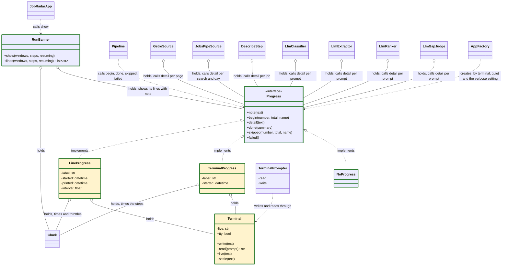
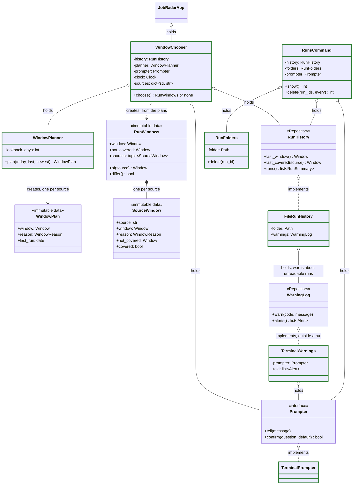
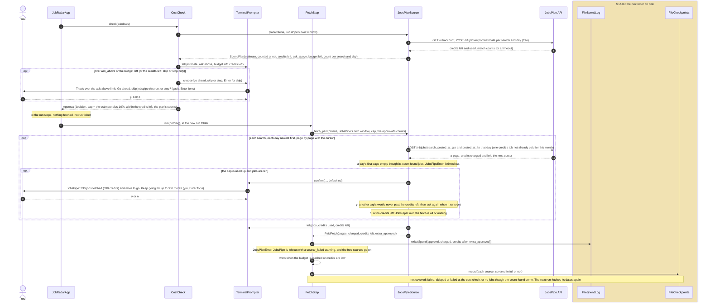

# Architecture

How the code is put together: which classes exist, what each one is responsible for, which others it knows, and where state lives. Every box is a real class, named as in the code. The reasons behind each part are in [design.md](design.md).

**Shown now:** the MVP as built (done Nov 10, tasks 1 to 26). One run goes from the command to the report: Fast Forward, and JobsPipe when it's on, then dedupe, the filter, and Claude labelling, reading and ranking jobs through `claude -p`, then the report with trends, asks and gaps. `--demo` runs the same steps offline, as the made-up person in `config_local_example/`. Every class shown works. Green borders marked what worked as each PR landed and were not added to every box, so a plain box is not an unbuilt one. Deferred after the MVP: keywords in descriptions and terminal prompts for user input. Each PR that changes the flow updates these diagrams.

**History:** the design for the first real run, agreed on Nov 4. PR #2 built it as a skeleton: every class and its signatures, no internals. PR #3 made the whole run work end to end on made-up data (`job-radar run --demo`), with every step in a simple form. PR #4 agrees each run's window with the user before anything is fetched. PR #5 fetches real Fast Forward jobs. PR #6 merges postings of the same job and filters on roles. PR #7 fetches full descriptions for the jobs the filter keeps. PR #8 numbers the step files in the run folder in run order. PR #9 ranks real runs with the LLM against your CV and preferences. PR #10 completes the report: work mode, salary and posted date for each job, a minimum score, YAML front matter, and a renderer that only formats. PR #11 is the first limited real run: default roles in code, and two layout fixes it found. PR #12 reads the user's settings over the defaults and the searches from their profile; a job is kept if it matches any search. PR #13 adds the search criteria on a posting's own fields: excluded titles, work mode, places as ISO codes, minimum salary, each with `if_missing`. PR #14 lists what the filter dropped, by reason, in `dropped.md` next to the report. PR #15 adds `job-radar runs` and `job-radar delete`. PR #16 resumes a failed run: the same command offers it, and the pipeline skips the saved steps. PR #17 notes in the report the days a long break left out. PR #18 merges postings on the employer's own id, read from ATS links, and on company, title and country. PR #19 drops jobs an earlier completed run already found, in `NewJobsFilterStep`. PR #20 adds JobsPipe, a paid API, off by default and capped per run, and moves the default settings into a YAML file, which the app reads first. PR #21 agrees what paid sources may spend before anything is fetched. PR #22 labels each job (seniority, job type, domain, sector) and adds a match step for the `seniority` and `domains` criteria. PR #23 finds what each matched job asks for: skills, tools, certifications and years. PR #24 carries jobs the LLM's usage limit stopped over to the next run. PR #25 adds market trends to the report: periods, coverage, figures, the change and notes on changed searches or sources. PR #26 adds the What employers ask for section. PR #27 adds the Experience to gain section. PR #28 completes the report: sources line, alerts, new openings grouped by job type, display names, terminal summary. PR #29 completes errors and warnings: a failing source no longer stops the run, warnings in the report and terminal, one run at a time. PR #30 adds the acceptance checklist. PR #31 adds a cap on jobs sent to the LLM, the README first-run walkthrough and an example CV. With it the MVP's tasks are done. PR #32 regroups the code into folders and moves defaults to config/ and personal files to config_local/. PR #33 adds config_local_example/, a copy-and-edit template of config_local/, which --demo runs on. PR #33 also opens the README with requirements and a quick start. After it, the per-run limits are named `llm.ask_above_jobs` and `sources.jobspipe.ask_above_credits`, and a JobsPipe fetch that reaches its cap asks to keep going instead of failing ("A paid source: the cost check and the fetch", below). Then each source tracks the dates it covered in full: a source that failed, was skipped or came back empty catches up in the next run, from its own window ("Agreeing the windows", below). Then JobsPipe asks one day at a time: one count and one search per search and day, and a day its count said had jobs that comes back empty fails JobsPipe for the run ("A paid source: the cost check and the fetch", below).

The first real run: `job-radar run` fetches Fast Forward through its search API, turns the records into postings, dedupes them into jobs, keeps the jobs that match the search, fetches their full descriptions, asks the LLM which fit the CV best, and writes a report with the top N and a few counts. The demo run takes the same steps, with a made-up board, the made-up person in `config_local_example/` and keyword scoring in place of the LLM.

## Code map

The package `job_radar/`, in reading order from the command down. A module is named after its main class, the interface it implements, or its step.

- `cli.py`: `Cli`, the `job-radar` command and the entry point
- `app/`: the app around a run: `JobRadarApp`, `AppFactory`, the window (`WindowPlanner`, `WindowChooser`), `ResumeOffer`, `CostCheck`, `RunBanner`, `RunsCommand` and the run results
- `pipeline/`: `Pipeline` and `Step`; `pipeline/steps/` has one module per step, named after it
- `sources/`: one adapter per job board (Getro, JobsPipe, demo), their interfaces and `BoardClient`
- `llm/`: `Llm` and `ClaudeCli`, the LLM passes (ranker, classifier, extractor, gap judge) and `UsageLimitGuard`
- `matching/`: `JobMatcher`, `JobKey`, `AtsLinks`, `PlaceCodes` and `Normalizer`: matching and identity without the LLM
- `report/`: the report sections (trends, asks, gaps, openings), `ReportRenderer`, `ReportWriter` and `Words`
- `storage/`: where state lives on disk: checkpoints, run history, seen jobs, the logs, the run lock and the gap cache
- `config/`: code that reads the user's files: settings, profile, searches, secrets
- `utils/`: `Clock`, `Prompter`, `Terminal` and `Progress` (what a run shows), `HtmlText` and the base errors
- `models/`: the domain models, by area; imported from `job_radar.models`

Defaults are in `config/` at the repo root; the user's overrides and personal files are in `config_local/` (never committed), under the same names. `config_local_example/` (committed) mirrors `config_local/` for a made-up person: a template to copy, and what `--demo` runs on.

## Rules the design follows

- **One responsibility per class**, and each class knows the fewest neighbours it can
- **Depend on interfaces.** Only `AppFactory` knows concrete classes
- **No state in memory.** Every class is configured once at creation and never changes. A run's state lives in its folder on disk, written only by `FileCheckpoints` and `FileReportWriter`
- **Steps exchange lists of models**, so one generic save and load works for every step

## Classes and dependencies

Three diagrams: the app and the pipeline that runs the steps, how the app agrees the run's windows, then the steps and what each one uses. Boxes marked with a pattern name (Repository, Adapter, Strategy) are interfaces.

### App and pipeline

```mermaid
classDiagram
    direction TB

    class Cli {
        +start()$
        +main(argv) int
    }
    class AppFactory {
        <<Factory>>
        -settings: Settings
        -local: Path
        -example: Path
        -clock: Clock
        -prompter: Prompter
        -terminal: Terminal
        +create(demo, quiet) JobRadarApp
    }
    class SettingsFile {
        -file: YamlFile
        +load() Settings
    }
    class SearchesFile {
        -file: YamlFile
        +load() SearchCriteria
    }
    class YamlFile {
        -path: Path
        +load(model) model
    }
    class Settings {
        <<immutable data>>
        +output, lookback_days
        +llm, recommend, sources
    }
    class SearchCriteria {
        <<immutable data>>
        +searches: tuple~Search~
    }
    class JobRadarApp {
        -offer: ResumeOffer
        -chooser: WindowChooser
        -cost: CostCheck
        -build: windows, run to resume, approvals, to Pipeline
        -lock: RunLock
        +run() RunResult
    }
    class RunLock {
        <<interface>>
        +enter() takes it
        +exit() releases it
    }
    class FileRunLock {
        -path: output/run.lock
        -pid: int
    }
    class ErrorLog {
        <<Repository>>
        +write(error) str
    }
    class FileErrorLog {
        -folder: Path
    }
    class CostCheck {
        -sources: list~PaidSource~
        -prompter: Prompter
        +check(windows) list~Approval~
    }
    class ResumeOffer {
        -history: RunHistory
        -prompter: Prompter
        +offer() RunSummary
    }
    class RunResult {
        <<abstract>>
        +message() str
        +exit_code() int
    }
    class RunSucceeded {
        +location: str
        +summary: str
        +alerts: tuple~str~
    }
    class RunFailed {
        +step: str
        +reason: str
        +details: str
    }
    class RunCancelled
    class Pipeline {
        -steps: list~Step~
        -checkpoints: Checkpoints
        -errors: ErrorLog
        -progress: Progress
        +run() RunResult
        +step_names() list~str~
    }
    class Step {
        <<interface>>
        +name: str
        +output: type
        +run(data) list
    }
    class Checkpoints {
        <<Repository>>
        +has(step) bool
        +save(step, items)
        +load(step, kind) list
        +complete()
    }
    class RunStats {
        <<interface>>
        +funnel() list~StepCount~
    }
    class CoverageLog {
        <<interface>>
        +record(covered)
    }
    class FileCheckpoints {
        -folder: Path
        -window: Window
        -sources: tuple~SourceWindow~
    }

    Cli ..> SettingsFile : calls load, before the factory
    SettingsFile ..> Settings : creates
    SettingsFile o-- YamlFile : holds
    AppFactory ..> SearchesFile : calls load, for a real run
    SearchesFile ..> SearchCriteria : creates
    SearchesFile o-- YamlFile : holds
    Cli ..> AppFactory : calls create, or runs_command
    Cli ..> RunsCommand : calls show, delete
    Cli ..> JobRadarApp : calls run
    Cli ..> RunResult : calls message, exit_code
    AppFactory ..> JobRadarApp : creates
    AppFactory ..> Pipeline : creates, for the agreed windows
    AppFactory ..> FileCheckpoints : creates
    JobRadarApp ..> Pipeline : has it built, calls run
    JobRadarApp o-- ResumeOffer : holds
    ResumeOffer o-- RunHistory : holds
    JobRadarApp ..> RunCancelled : creates
    Pipeline o-- Step : holds, in order
    Pipeline o-- Checkpoints : holds
    Pipeline ..> RunSucceeded : creates
    Pipeline ..> RunFailed : creates
    RunResult <|-- RunSucceeded : extends
    RunResult <|-- RunFailed : extends
    RunResult <|-- RunCancelled : extends
    Checkpoints <|.. FileCheckpoints : implements
    RunStats <|.. FileCheckpoints : implements
    CoverageLog <|.. FileCheckpoints : implements
    JobRadarApp o-- RunLock : holds, taken around the run
    RunLock <|.. FileRunLock : implements
    Pipeline o-- ErrorLog : holds, for a step's bug
    Pipeline o-- Progress : holds, tells each step's start and end
    JobRadarApp o-- RunBanner : holds, shown before the pipeline runs
    Cli ..> ErrorLog : calls write, for a bug outside any step
    ErrorLog <|.. FileErrorLog : implements

    style Cli stroke:#2e7d32,stroke-width:3px
    style AppFactory stroke:#2e7d32,stroke-width:3px
    style SettingsFile stroke:#2e7d32,stroke-width:3px
    style SearchesFile stroke:#2e7d32,stroke-width:3px
    style YamlFile stroke:#2e7d32,stroke-width:3px
    style JobRadarApp stroke:#2e7d32,stroke-width:3px
    style RunResult stroke:#2e7d32,stroke-width:3px
    style RunSucceeded stroke:#2e7d32,stroke-width:3px
    style RunFailed stroke:#2e7d32,stroke-width:3px
    style RunCancelled stroke:#2e7d32,stroke-width:3px
    style Pipeline stroke:#2e7d32,stroke-width:3px
    style FileCheckpoints stroke:#2e7d32,stroke-width:3px
    style FileRunLock stroke:#2e7d32,stroke-width:3px
    style FileErrorLog stroke:#2e7d32,stroke-width:3px
```



`JobRadarApp` holds `WindowChooser` (next diagram). `Progress` and `RunBanner` are in "Run progress" below.

### Run progress

What a run shows. The pipeline tells `Progress` when each step starts and ends; the slow steps and sources tell it what they are doing now. The factory gives the same `Progress` to all of them, and one `Terminal` writes for both it and the prompter, so a question or a message never lands on the live line. State is shaded.



### Agreeing the windows

Each source gets its own window, from where the last completed run that covered it in full ended. The run's window spans them all.



### Steps and what they use

```mermaid
classDiagram
    direction TB

    class Step {
        <<interface>>
        +name: str
        +output: type
        +run(data) list
    }
    class FetchStep {
        -sources: list~JobBoardSource~
        -criteria: SearchCriteria
        -windows: RunWindows
        -approvals: dict~str, Approval~
        -log: SpendLog
        -warnings: WarningLog
        -low_credits: int
        -coverage: CoverageLog
    }
    class WarningLog {
        <<Repository>>
        +warn(code, message)
        +alerts() list~Alert~
    }
    class FileWarningLog {
        -folder: Path
    }
    class PaidSource {
        <<interface>>
        +plan(criteria, window) SpendPlan
        +fetch_paid(criteria, window, cap, counts) PaidFetch
    }
    class SpendLog {
        <<interface>>
        +write(spend)
        +spends() list~Spend~
    }
    class FileSpendLog {
        -folder: Path
    }
    class JobBoardSource {
        <<Adapter>>
        +name: str
        +label: str
        +fetch(criteria, window) list~RawPage~
    }
    class GetroSource {
        -network: str
        -client: BoardClient
    }
    class JobsPipeSource {
        -client: BoardClient
        -filters: dict
        -ask_above: int
        -budget: int
        -prompter: Prompter
        +query(search, day) dict
    }
    class JobsPipeParser
    class Secrets {
        <<interface>>
        +get(name) str
    }
    class EnvSecrets {
        -path: Path
    }
    class BoardClient {
        -http: httpx.Client
        -delay: float
        +pause()
        +get(url) Response
        +post(url) Response
    }
    class DemoSource
    class ConvertStep {
        -parsers: dict~str, JobBoardParser~
        -counts: SourceCountLog
        -warnings: WarningLog
        -labels: dict~str, str~
    }
    class SourceCountLog {
        <<interface>>
        +write(counts)
        +counts() list~SourceCount~
    }
    class FileSourceCountLog {
        -folder: Path
    }
    class JobBoardParser {
        <<Adapter>>
        +source: str
        +parse(page) list~Posting~
    }
    class GetroParser
    class DemoParser
    class DedupeStep {
        -key: JobKey
        -today: date
    }
    class NewJobsFilterStep {
        -seen: SeenJobs
        -today: date
        -new_only: bool
    }
    class SeenJobs {
        <<interface>>
        +keys(today) frozenset~str~
    }
    class FileSeenJobs {
        -history: RunHistory
        -folder: Path
        -warnings: WarningLog
    }
    class JobKey {
        -normalizer: Normalizer
        -ats: AtsLinks
        +keys(posting) tuple~str~
        +fuzzy(posting) str
    }
    class AtsLinks {
        +key(url) str
    }
    class Normalizer {
        +company(name) str
        +title(title, places) str
        +place(place) str
    }
    class FilterStep {
        -criteria: SearchCriteria
        -windows: RunWindows
        -matcher: JobMatcher
        -log: DropLog
    }
    class DropLog {
        <<interface>>
        +write(drops)
    }
    class FileDropLog {
        -folder: Path
        -words: Words
    }
    class Words {
        +details(posting) str
        +day(day) str
        +span(start, end) str
    }
    class JobMatcher {
        -normalizer: Normalizer
        +miss(job, search) str
    }
    class PlaceCodes {
        +locate(location) Location
    }
    class DescribeStep {
        -describers: dict~str, JobDescriber~
        -prompter: Prompter
    }
    class LlmCapStep {
        -cap: int
        -prompter: Prompter
        -pending: PendingLog
        -warnings: WarningLog
    }
    class ClassifyStep {
        -classifier: Classifier
        -prompter: Prompter
        -warnings: WarningLog
    }
    class Classifier {
        <<Strategy>>
        +classify(jobs) dict~str, Classification~
    }
    class LlmClassifier {
        -llm: Llm
        -job_types: dict
        -domains: dict
    }
    class TitleClassifier
    class MatchStep {
        -criteria: SearchCriteria
        -matcher: JobMatcher
    }
    class ExtractStep {
        -extractor: Extractor
        -prompter: Prompter
        -guard: UsageLimitGuard
        -warnings: WarningLog
    }
    class UsageLimitGuard {
        -prompter: Prompter
        -pending: PendingLog
        -warnings: WarningLog
        +run(work, jobs, verb) tuple
    }
    class PendingLog {
        <<interface>>
        +add(jobs)
        +jobs() list~Job~
    }
    class FilePendingLog {
        -folder: Path
    }
    class CarriedOverStep {
        -pending: PendingJobs
    }
    class LastRunPending {
        -history: RunHistory
        -folder: Path
    }
    class Extractor {
        <<Strategy>>
        +extract(jobs) dict~str, Extraction~
    }
    class LlmExtractor {
        -llm: Llm
    }
    class KeywordExtractor
    class JobDescriber {
        <<Adapter>>
        +source: str
        +pace: float
        +describe(posting) str
    }
    class GetroDescriber {
        -network: str
        -client: BoardClient
        -html: HtmlText
    }
    class HtmlText {
        +text(html) str
    }
    class RecommendTopJobsStep {
        -ranker: JobRanker
        -profile: CandidateProfile
        -top_n: int
        -warnings: WarningLog
    }
    class JobRanker {
        <<Strategy>>
        +score(jobs, profile) list~Recommendation~
    }
    class LlmRanker {
        -llm: Llm
        -batch_size: int
        -description_chars: int
    }
    class KeywordRanker
    class Llm {
        <<interface>>
        +complete(system, prompt, schema) str
    }
    class ClaudeCli {
        -model: str
        -timeout: float
        +check()
    }
    class ProfileLoader {
        -folder: Path
        +load() CandidateProfile
    }
    class CandidateProfile {
        <<immutable data>>
        +cv: str
        +preferences: str
    }
    class ReportStep {
        -stats: RunStats
        -renderer: ReportRenderer
        -writer: ReportWriter
        -trends: TrendSource
        -asks: AskSource
        -gaps: GapSource
        -run_id: str
        -windows: RunWindows
        -min_score: int
        -sources: dict~str, str~
        -counts: SourceCountLog
        -this_run: KeptJobs
        -grouper: OpeningGrouper
        -warnings: WarningLog
    }
    class OpeningGrouper {
        -levels: tuple~str~
        -names: dict
        +group(jobs, scores) tuple~OpeningGroup~
    }
    class KeptJobs {
        <<interface>>
        +kept(kind) list
    }
    class TrendSource {
        <<interface>>
        +trends() Trends
    }
    class MarketTrends {
        -runs: RunsSource
        -builder: TrendBuilder
    }
    class TrendBuilder {
        -period: str
        +build(runs) Trends
    }
    class RunsSource {
        <<interface>>
        +runs() list~RunJobs~
    }
    class MarketRuns {
        -history: RunHistory
        -seen: SeenJobs
        -this_run: KeptJobs
    }
    class AskSource {
        <<interface>>
        +asks() Asks
    }
    class MarketAsks {
        -runs: RunsSource
        -builder: AskBuilder
        -today: date
    }
    class AskBuilder {
        -days: int
        -per_type: int
        -names: RequirementNames
        +build(jobs, today) Asks
    }
    class RequirementNames {
        +key(name) str
    }
    class GapSource {
        <<interface>>
        +gaps(asks) Gaps
    }
    class CvGaps {
        -profile: CandidateProfile
        -judge: GapJudge
        -cache: GapCache
        -builder: GapBuilder
        -warnings: WarningLog
    }
    class GapBuilder {
        -names: RequirementNames
        -suggestions: int
        +key(row) RequirementKey
        +ranked(rows) list~AskRow~
        +build(rows, judged, skipped) Gaps
    }
    class GapJudge {
        <<Strategy>>
        +judge(asked, profile) list~GapJudgment~
    }
    class LlmGapJudge {
        -llm: Llm
    }
    class KeywordGapJudge
    class GapCache {
        <<Repository>>
        +judged(cv) dict
        +add(cv, judged)
    }
    class FileGapCache {
        -path: Path
    }
    class ReportRenderer {
        <<interface>>
        +render(content) str
    }
    class MarkdownRenderer {
        -words: Words
    }
    class ReportContent {
        <<immutable data>>
        +run: str
        +window: Window
        +not_covered: Window
        +source_windows: tuple~SourceWindow~
        +sources: tuple~SourceSummary~
        +alerts: tuple~Alert~
        +min_score: int
        +recommendations: tuple~Recommendation~
        +openings: tuple~OpeningGroup~
        +funnel: tuple~StepCount~
        +new_openings() int
    }
    class RunStats {
        <<interface>>
        +funnel() list~StepCount~
    }
    class ReportWriter {
        <<interface>>
        +write(text) str
    }
    class FileReportWriter {
        -folder: Path
    }

    Step <|.. FetchStep : implements
    Step <|.. ConvertStep : implements
    Step <|.. DedupeStep : implements
    Step <|.. NewJobsFilterStep : implements
    NewJobsFilterStep o-- SeenJobs : holds
    SeenJobs <|.. FileSeenJobs : implements
    Step <|.. FilterStep : implements
    Step <|.. DescribeStep : implements
    Step <|.. LlmCapStep : implements
    LlmCapStep o-- PendingLog : holds, carries over the jobs over the cap
    Step <|.. ClassifyStep : implements
    Step <|.. MatchStep : implements
    ClassifyStep o-- Classifier : holds
    Classifier <|.. LlmClassifier : implements
    Classifier <|.. TitleClassifier : implements
    LlmClassifier o-- Llm : holds
    MatchStep o-- JobMatcher : holds
    Step <|.. ExtractStep : implements
    Step <|.. CarriedOverStep : implements
    ExtractStep o-- UsageLimitGuard : holds
    ClassifyStep o-- UsageLimitGuard : holds
    RecommendTopJobsStep o-- UsageLimitGuard : holds
    UsageLimitGuard o-- PendingLog : holds
    PendingLog <|.. FilePendingLog : implements
    CarriedOverStep o-- LastRunPending : holds
    ExtractStep o-- Extractor : holds
    Extractor <|.. LlmExtractor : implements
    Extractor <|.. KeywordExtractor : implements
    LlmExtractor o-- Llm : holds
    Step <|.. RecommendTopJobsStep : implements
    Step <|.. ReportStep : implements
    FetchStep o-- JobBoardSource : holds, one per board
    JobBoardSource <|.. GetroSource : implements
    JobBoardSource <|.. JobsPipeSource : implements
    PaidSource <|.. JobsPipeSource : implements
    JobRadarApp o-- CostCheck : holds
    CostCheck o-- PaidSource : holds
    FetchStep o-- SpendLog : holds
    SpendLog <|.. FileSpendLog : implements
    FetchStep o-- WarningLog : holds, warns
    FetchStep o-- CoverageLog : holds, records the sources covered in full
    ConvertStep o-- WarningLog : holds, warns
    ClassifyStep o-- WarningLog : holds, warns
    ExtractStep o-- WarningLog : holds, warns
    LlmCapStep o-- WarningLog : holds, warns
    RecommendTopJobsStep o-- WarningLog : holds, warns
    UsageLimitGuard o-- WarningLog : holds, warns
    CvGaps o-- WarningLog : holds, warns
    FileSeenJobs o-- WarningLog : holds, warns
    ReportStep o-- WarningLog : holds, warns and reads the alerts
    WarningLog <|.. FileWarningLog : implements, one per run
    JobsPipeSource o-- BoardClient : holds, with the key
    JobBoardSource <|.. DemoSource : implements
    GetroSource o-- BoardClient : holds
    ConvertStep o-- JobBoardParser : holds, one per board
    ConvertStep o-- SourceCountLog : holds
    SourceCountLog <|.. FileSourceCountLog : implements
    JobBoardParser <|.. GetroParser : implements
    JobBoardParser <|.. JobsPipeParser : implements
    JobsPipeParser o-- PlaceCodes : holds
    Secrets <|.. EnvSecrets : implements
    JobBoardParser <|.. DemoParser : implements
    DedupeStep o-- JobKey : holds
    JobKey o-- Normalizer : holds
    JobKey o-- AtsLinks : holds
    FilterStep o-- JobMatcher : holds
    FilterStep o-- DropLog : holds
    DropLog <|.. FileDropLog : implements
    FileDropLog o-- Words : holds
    MarkdownRenderer o-- Words : holds
    JobMatcher o-- Normalizer : holds
    GetroParser o-- PlaceCodes : holds
    DemoParser o-- PlaceCodes : holds
    DescribeStep o-- JobDescriber : holds, one per board that needs it
    JobDescriber <|.. GetroDescriber : implements
    GetroDescriber o-- BoardClient : holds, shared with GetroSource
    GetroDescriber o-- HtmlText : holds
    RecommendTopJobsStep o-- JobRanker : holds
    JobRanker <|.. LlmRanker : implements
    JobRanker <|.. KeywordRanker : implements
    LlmRanker o-- Llm : holds
    Llm <|.. ClaudeCli : implements
    RecommendTopJobsStep o-- CandidateProfile : holds
    ProfileLoader ..> CandidateProfile : creates
    ReportStep o-- RunStats : holds
    ReportStep o-- TrendSource : holds
    TrendSource <|.. MarketTrends : implements
    MarketTrends o-- TrendBuilder : holds
    MarketTrends o-- RunsSource : holds
    RunsSource <|.. MarketRuns : implements
    MarketRuns o-- RunHistory : holds
    MarketRuns o-- SeenJobs : holds, reads each run's kept jobs
    ReportStep o-- AskSource : holds
    AskSource <|.. MarketAsks : implements
    MarketAsks o-- RunsSource : holds
    MarketAsks o-- AskBuilder : holds
    AskBuilder o-- RequirementNames : holds
    ReportStep o-- GapSource : holds
    GapSource <|.. CvGaps : implements
    CvGaps o-- CandidateProfile : holds
    CvGaps o-- GapJudge : holds
    GapJudge <|.. LlmGapJudge : implements
    GapJudge <|.. KeywordGapJudge : implements
    LlmGapJudge o-- Llm : holds
    CvGaps o-- GapCache : holds
    GapCache <|.. FileGapCache : implements
    CvGaps o-- GapBuilder : holds
    GapBuilder o-- RequirementNames : holds
    ReportStep o-- SourceCountLog : holds, reads
    ReportStep o-- KeptJobs : holds, this run's matched jobs
    MarketRuns o-- KeptJobs : holds
    ReportStep o-- OpeningGrouper : holds
    ReportStep o-- ReportRenderer : holds
    ReportStep ..> ReportContent : creates
    ReportRenderer <|.. MarkdownRenderer : implements
    ReportStep o-- ReportWriter : holds
    ReportWriter <|.. FileReportWriter : implements

    style FetchStep stroke:#2e7d32,stroke-width:3px
    style FileSpendLog stroke:#2e7d32,stroke-width:3px
    style FileWarningLog stroke:#2e7d32,stroke-width:3px
    style FileSourceCountLog stroke:#2e7d32,stroke-width:3px
    style OpeningGrouper stroke:#2e7d32,stroke-width:3px
    style CostCheck stroke:#2e7d32,stroke-width:3px
    style ConvertStep stroke:#2e7d32,stroke-width:3px
    style DedupeStep stroke:#2e7d32,stroke-width:3px
    style JobKey stroke:#2e7d32,stroke-width:3px
    style AtsLinks stroke:#2e7d32,stroke-width:3px
    style Normalizer stroke:#2e7d32,stroke-width:3px
    style FilterStep stroke:#2e7d32,stroke-width:3px
    style FileSeenJobs stroke:#2e7d32,stroke-width:3px
    style NewJobsFilterStep stroke:#2e7d32,stroke-width:3px
    style Words stroke:#2e7d32,stroke-width:3px
    style FileDropLog stroke:#2e7d32,stroke-width:3px
    style PlaceCodes stroke:#2e7d32,stroke-width:3px
    style JobMatcher stroke:#2e7d32,stroke-width:3px
    style DescribeStep stroke:#2e7d32,stroke-width:3px
    style LlmCapStep stroke:#2e7d32,stroke-width:3px
    style ClassifyStep stroke:#2e7d32,stroke-width:3px
    style LlmClassifier stroke:#2e7d32,stroke-width:3px
    style TitleClassifier stroke:#2e7d32,stroke-width:3px
    style MatchStep stroke:#2e7d32,stroke-width:3px
    style ExtractStep stroke:#2e7d32,stroke-width:3px
    style UsageLimitGuard stroke:#2e7d32,stroke-width:3px
    style FilePendingLog stroke:#2e7d32,stroke-width:3px
    style CarriedOverStep stroke:#2e7d32,stroke-width:3px
    style LastRunPending stroke:#2e7d32,stroke-width:3px
    style LlmExtractor stroke:#2e7d32,stroke-width:3px
    style KeywordExtractor stroke:#2e7d32,stroke-width:3px
    style GetroDescriber stroke:#2e7d32,stroke-width:3px
    style BoardClient stroke:#2e7d32,stroke-width:3px
    style HtmlText stroke:#2e7d32,stroke-width:3px
    style RecommendTopJobsStep stroke:#2e7d32,stroke-width:3px
    style ReportStep stroke:#2e7d32,stroke-width:3px
    style TrendBuilder stroke:#2e7d32,stroke-width:3px
    style MarketTrends stroke:#2e7d32,stroke-width:3px
    style MarketRuns stroke:#2e7d32,stroke-width:3px
    style MarketAsks stroke:#2e7d32,stroke-width:3px
    style AskBuilder stroke:#2e7d32,stroke-width:3px
    style RequirementNames stroke:#2e7d32,stroke-width:3px
    style CvGaps stroke:#2e7d32,stroke-width:3px
    style GapBuilder stroke:#2e7d32,stroke-width:3px
    style LlmGapJudge stroke:#2e7d32,stroke-width:3px
    style KeywordGapJudge stroke:#2e7d32,stroke-width:3px
    style FileGapCache stroke:#2e7d32,stroke-width:3px
    style FileReportWriter stroke:#2e7d32,stroke-width:3px
    style MarkdownRenderer stroke:#2e7d32,stroke-width:3px
    style DemoSource stroke:#2e7d32,stroke-width:3px
    style GetroSource stroke:#2e7d32,stroke-width:3px
    style EnvSecrets stroke:#2e7d32,stroke-width:3px
    style JobsPipeParser stroke:#2e7d32,stroke-width:3px
    style JobsPipeSource stroke:#2e7d32,stroke-width:3px
    style GetroParser stroke:#2e7d32,stroke-width:3px
    style DemoParser stroke:#2e7d32,stroke-width:3px
    style KeywordRanker stroke:#2e7d32,stroke-width:3px
    style LlmRanker stroke:#2e7d32,stroke-width:3px
    style ClaudeCli stroke:#2e7d32,stroke-width:3px
    style ProfileLoader stroke:#2e7d32,stroke-width:3px
```

How to read the arrows:

| Arrow | Means |
|---|---|
| `..\|>` dashed, hollow triangle | Implements the interface |
| `--\|>` solid, hollow triangle | Extends the class |
| `..>` dashed | Uses: calls the named functions, or creates the object |
| `o--` hollow diamond | Holds as a configured part, set once at creation, never changed |
| Green border | Works now, some in a simple form ([tasks.md](tasks.md) says which); no colour means signatures only, or an interface |

### What each step takes and gives

The pipeline saves each step's output and passes it to the next step in memory. Only a resumed run reads from disk, once, to get the last saved output.

| Step | Name in the run folder | Takes | Gives |
|---|---|---|---|
| `FetchStep` | `fetch` | nothing | `RawPage`s from each job board |
| `ConvertStep` | `convert` | `RawPage`s | `Posting`s |
| `DedupeStep` | `dedupe` | `Posting`s | `Job`s, one per real job |
| `NewJobsFilterStep` | `new_jobs_filter` | `Job`s | the `Job`s no earlier completed run found |
| `FilterStep` | `filter` | `Job`s | `Job`s that match any search |
| `CarriedOverStep` | `carried_over` | `Job`s | the same `Job`s, then those the last completed run carried over that this run didn't find again |
| `DescribeStep` | `describe` | `Job`s | the same `Job`s, each primary posting with its full description |
| `LlmCapStep` | `llm_cap` | `Job`s | the `Job`s that go on to the LLM: all of them, or the first ones up to `llm.ask_above_jobs` when the user says so |
| `ClassifyStep` | `classify` | `Job`s | the same `Job`s, each with its labels (none when the LLM couldn't) |
| `MatchStep` | `match` | `Job`s | the `Job`s that meet every criterion of a search, labels included |
| `ExtractStep` | `extract` | `Job`s | the same `Job`s, each with its requirements (none when the LLM couldn't) |
| `RecommendTopJobsStep` | `recommend` | `Job`s | the top N `Recommendation`s at or above the minimum score, each with its `Job`, a score and a reason |
| `ReportStep` | `report` | `Recommendation`s | `Report`: where it is and a one-line summary (new openings, recommended, alerts) |

## Responsibilities and neighbours

One responsibility per class. "Knows" is everything the class imports or calls; nothing else.

| Class | Pattern | Responsibility | Knows |
|---|---|---|---|
| `Cli` | Entry point | Turn the command line into a call; print the result; return the exit code. A setup error prints its message with the fix (exit 2); a bug outside any step goes to `output/error.log` with one line (exit 1, or 2 while setting up); Ctrl+C prints one line | `AppFactory`, `JobRadarApp`, `RunResult`, `ErrorLog` |
| `AppFactory` | Factory | Build the app for one command, real or demo. The only class that knows concrete classes | all of them |
| `SettingsFile` | | Read `config/settings.yaml`, then merge `config_local/settings.yaml` over it at any depth; no local file means every default. `Settings` holds only types and limits | `YamlFile`, `Settings` |
| `SearchesFile` | | Read the searches from `config_local/profile.yaml` (the demo: `config_local_example/profile.yaml`), filling each from `common`; required for a real run | `YamlFile`, `SearchCriteria` |
| `YamlFile` | | Read one YAML file into a model; errors name the file and the key's path | `pyyaml`, models |
| `JobRadarApp` | | Take the run lock; resume the last run if it failed and the user says yes, or agree new windows; have the pipeline built for them, show the start banner, launch it, and hand back how it ended; release the lock however it ends | `ResumeOffer`, `WindowChooser`, `CostCheck`, `RunBanner`, `Pipeline`, `RunResult`, `RunLock` |
| `RunLock`, `FileRunLock` | Interface | One run at a time: `output/run.lock` holds the running process's id; a lock whose process no longer exists is removed; a live one raises `RunInProgress` | the output folder |
| `JobRadarError`, `SetupError` | Exceptions | The errors the app expects, each with a message that says what's wrong and how to fix it; `SetupError` stops a run before it starts (`ConfigError`, `ProfileError`, `LlmUnavailable`, `RunInProgress`). Anything else is a bug | nothing |
| `ErrorLog`, `FileErrorLog` | Repository | Write an unexpected error's traceback to `error.log`, in the run folder or the output folder, and say where | its folder |
| `WarningLog`, `FileWarningLog` | Repository | Collect a run's warnings (`Alert`: a code and a message), each once, in `warnings.jsonl` in its run folder, kept after the run; the report step reads them as the alerts | its run folder |
| `TerminalWarnings` | Implements `WarningLog` | Outside a run, tell each warning once in the terminal; remembers what it told (stateful, for one command) | `Prompter` |
| `ResumeOffer` | | When the newest run didn't complete, ask whether to resume it (Enter for yes) | `RunHistory`, `Prompter`, `Words` |
| `RunResult`, `RunSucceeded`, `RunFailed`, `RunCancelled` | Polymorphism | Say how a run ended, in words and as an exit code | nothing |
| `WindowChooser` | | Work out each source's window; tell the user which dates the run fetches and why, a line per source when they differ; ask first when a source was never covered or was last covered before the lookback | `RunHistory`, `WindowPlanner`, `Prompter`, `Clock` |
| `WindowPlanner` | | Decide a source's window from today, the last completed run that covered it, the newest completed run and the lookback | `Window` |
| `RunHistory`, `FileRunHistory` | Repository | Read-only: every run (id, windows, completed or not, its steps), the window of the last completed one, and each source's window in the last completed run that covered it, from the run folders; a folder whose manifest can't be read is left out with a warning | the run folders, `WarningLog` |
| `RunFolders` | | Delete a run folder, only one that exists directly under the runs folder | the run folders |
| `RunsCommand` | | `job-radar runs`: list runs, newest first. `job-radar delete`: delete runs after asking, Enter meaning no | `RunHistory`, `RunFolders`, `Prompter`, `Words` |
| `Prompter`, `TerminalPrompter` | Interface | Tell the user things and ask yes or no in the terminal, through the `Terminal` | `Terminal` |
| `Terminal` | | The one writer to the terminal: print a line, ask a question, show one live line redrawn in place. Clears the live line before anything else is written or asked and draws it again after (stateful: the live line) | the output stream |
| `Progress`, `NoProgress`, `TerminalProgress`, `LineProgress` | Interface | Show a numbered line per step with its count and time, and live counts inside slow steps: in place on a terminal, one throttled line per update otherwise, nothing when quiet (the terminal and line ones are stateful: the current step's label and start) | `Terminal`, `Clock` |
| `RunBanner` | | Before the pipeline starts, show the config folder, searches, each source with its dates, limits, model and the step list | `Progress`, `Clock` |
| `Pipeline` | Pipeline | Run the steps in order; skip the steps already saved and read the last of them back; save each output; turn an error into `RunFailed` (a bug's traceback to the error log) and the final `Report` into `RunSucceeded`, with its alerts; delete the checkpoints on success; tell `Progress` each step's start, end (with its count), skip or failure | `Step`, `Checkpoints`, `ErrorLog`, `Progress`, `Report`, `RunResult` |
| `Step` | Interface | The shape every step shares | models |
| `Checkpoints` | Repository | Save and load each step's output for one run; record counts in the manifest; once the run succeeds, mark it completed and delete the outputs | models |
| `RunStats` | Interface | Read-only: how many items each finished step produced | models |
| `FileCheckpoints` | Implements both | One JSON Lines file per step, numbered in run order (`01-fetch.jsonl`), plus `manifest.json` (the window, each source's window and whether the fetch covered it, each step's count, completed or not), in the run folder | its run folder |
| `FetchStep` | Step | Fetch raw pages from every configured job board, each for its own window; a paid one within its approval, or not at all when skipped, recording what it spent. A board that fails is left out with a warning; when every board tried fails, raise `NoSourceData` naming each. Warn about a board that gave nothing, one skipped by you, a budget reached and credits below `alerts.low_credits`. Record which boards it covered in full: not one that failed, was skipped, or gave nothing though its count found jobs | `JobBoardSource`, `PaidSource`, `SpendLog`, `WarningLog`, `CoverageLog` |
| `CostCheck` | | Before anything is fetched: each paid source's free estimate, for its own window, against the ask-above limit, the budget and the credits left; go ahead on its own within them, else ask go ahead, skip or stop (Enter for skip). A source whose check fails is left out as `failed` | `PaidSource`, `Prompter` |
| `SpendLog`, `FileSpendLog` | Repository | Keep what each paid source spent in a run, in `spend.jsonl`; the report reads it | its run folder |
| `JobBoardSource`, `GetroSource` | Adapter | Query one board's API, page by page, and give the board's name for people (`label`: "Fast Forward" for Getro network 997, "JobsPipe", "Demo board"); `GetroSource` stops at the page that reaches past the window | `BoardClient` |
| `JobsPipeSource` | Adapter, `PaidSource` | One JobsPipe search per user search and day of the window, newest day first, with the criteria and the JobsPipe-only filters sent; cursor paging within the agreed cap; reaching it with jobs left, ask to keep going for another cap's worth within the credits left (Enter for no, which fails the source). Its plan is free: the account's credits and the matches counted per search and day, added up, passed on through the approval, so a day counted with jobs that comes back empty fails the fetch; the plan (free, seeker) sets the ask-above limit and monthly budget unless settings override them | `BoardClient`, `Prompter` |
| `JobsPipeParser` | Adapter | Turn JobsPipe records into `Posting`s: its country and state codes, work arrangement, yearly pay, full description | `PlaceCodes`, `HtmlText` |
| `Secrets`, `EnvSecrets` | Interface | Read an API key from the environment, else from `config_local/.env` | the environment, `config_local/.env` |
| `BoardClient` | | Send one board's requests at its pace (1s for Getro), retrying timeouts, server errors and rate limits; say a failure in a few words as a `BoardError` ("HTTP 503 after 3 retries") | the board's API |
| `ConvertStep` | Step | Send each raw page to the parser for its board; record how many postings each board gave, zero included; warn about a board whose pages hold none | `JobBoardParser`, `SourceCountLog`, `WarningLog` |
| `SourceCountLog`, `FileSourceCountLog` | Repository | Keep how many postings each source gave in a run, in `source_counts.jsonl`, kept after the run; the report's header reads it | its run folder |
| `JobBoardParser`, `GetroParser` | Adapter | Turn one board's records into `Posting`s, places with their codes | the board's format, `PlaceCodes` |
| `PlaceCodes` | | Read country and region ISO codes from a place's text ("Seattle, WA, USA" is `US`, `US-WA`); none when it can't ("Remote") | `pycountry` |
| `DemoSource`, `DemoParser` | Adapter | A made-up board: the same postings every run, for `--demo` and tests | `Posting` |
| `DedupeStep` | Step | Group postings that share any key into one `Job`, transitively; the job's id is its primary posting's strongest key | `JobKey` |
| `JobKey` | | A posting's identity keys: the ATS key from its link, if any, and a fuzzy key on company, title and countries in canonical form | `Posting`, `Normalizer`, `AtsLinks` |
| `AtsLinks` | | Read the employer's id for an opening from a Greenhouse, Lever, Ashby or Workable link | nothing |
| `Normalizer` | | Put company names, titles and places in canonical form for comparing | nothing |
| `NewJobsFilterStep` | Step | Drop jobs with a key an earlier completed run kept; with `new_only` off, keep all | `SeenJobs` |
| `SeenJobs`, `FileSeenJobs` | Repository | Read-only: the jobs each completed run kept in `jobs.jsonl`, and their keys; strong keys for good, fuzzy keys for 60 days. A kept file that can't be read counts as none, with a warning | `RunHistory`, the run folders, `WarningLog` |
| `FilterStep` | Step | Keep the jobs posted in their source's window that match any search | `SearchCriteria`, `RunWindows`, `JobMatcher` |
| `JobMatcher` | | Say whether a job meets one search, and which criterion it fails first: roles, excluded title, work mode, location, salary; `if_missing` settles what the posting doesn't say | `Normalizer` |
| `DescribeStep` | Step | Fill in the full description of each kept job's primary posting, through the describer for its board; say first how long it takes. Jobs that have one, or whose board has no describer, pass through | `JobDescriber`, `Prompter` |
| `LlmCapStep` | Step | A safety cap before the first LLM step: over `llm.ask_above_jobs` (60), ask whether to send all, only the first ones (the rest carried over, a warning) or stop before any LLM call (Enter for the first ones); under it, ask nothing | `Prompter`, `PendingLog`, `WarningLog` |
| `ClassifyStep` | Step | Add labels to every job; say how many the classifier couldn't label, and warn | `Classifier`, `Prompter`, `WarningLog` |
| `Classifier`, `LlmClassifier`, `TitleClassifier` | Strategy | Label seniority, job type, domain and sector: `LlmClassifier` 50 jobs a prompt from the start of each description, job types and domains from settings, a retry then a split per bad answer; `TitleClassifier` seniority and job type from title words, for `--demo` | `Llm` |
| `MatchStep` | Step | Keep the jobs that meet every criterion of some search, now with seniority and domain | `SearchCriteria`, `JobMatcher` |
| `UsageLimitGuard` | | Run one LLM pass (classify, extract, rank); when the usage limit stops it, ask finish and carry the rest over (a warning), or stop (Enter for finish) | `Prompter`, `PendingLog`, `WarningLog` |
| `PendingLog`, `FilePendingLog` | Repository | Keep the jobs a run carries over in `pending.jsonl`, kept after the run | its run folder |
| `CarriedOverStep`, `LastRunPending` | Step | Add the last completed run's carried-over jobs after the filter, unless this run found them again | `RunHistory`, the run folders |
| `ExtractStep` | Step | Add requirements to every matched job; say how many the extractor couldn't read, and warn | `Extractor`, `Prompter`, `WarningLog` |
| `Extractor`, `LlmExtractor`, `KeywordExtractor` | Strategy | Find what a posting asks for, as skills, tools, certifications and years: `LlmExtractor` 10 jobs a prompt from descriptions up to 8,000 characters, a retry then a split per bad answer, names only tidied; `KeywordExtractor` a short list of names, for `--demo` | `Llm` |
| `JobDescriber`, `GetroDescriber` | Adapter | Fetch one posting's description as plain text; `GetroDescriber` makes one request per job and gives nothing for a job the board no longer has or lists | `BoardClient`, `HtmlText` |
| `HtmlText` | | Turn HTML into plain text that keeps paragraphs, line breaks and lists | nothing |
| `RecommendTopJobsStep` | Step | Keep the N best-scored jobs that reach the minimum score (40 by default); warn about jobs the ranker couldn't score | `JobRanker`, `CandidateProfile`, `WarningLog` |
| `JobRanker`, `LlmRanker` | Strategy | Score jobs against the CV and preferences, 20 to a prompt, with a JSON schema; check the answer scores every job once, ask again once if not, then split the batch; a job that still fails gets no score | `Llm` |
| `KeywordRanker` | Strategy | Score a job by the share of its title words found in the profile, for `--demo` and tests | models |
| `Llm`, `ClaudeCli` | Interface | Send one prompt to a language model; `ClaudeCli` runs `claude -p` on the subscription, one plain turn from an empty folder, and checks the login before a run | `claude` |
| `ProfileLoader` | | Read the CV (`cv.pdf`, `cv.md` or `cv.txt`) and `preferences.md` from `config_local/` (the demo: `config_local_example/`) into a `CandidateProfile`; say what's missing | `config_local/`, `config_local_example/` |
| `ReportStep` | Step | Put together what the report says (`ReportContent`: the run, its window, each source's own window when they differ, its sources with postings and credits, the alerts, the recommended jobs, the new openings by group, the market trends, what employers ask for, how the CV compares with it, the funnel), then have it formatted and written; its summary for the terminal counts new openings, recommended jobs and alerts and gives each alert. Warns when no new job matched, then reads every warning of the run as the alerts | `RunStats`, `SourceCountLog`, `SpendLog`, `KeptJobs`, `OpeningGrouper`, `TrendSource`, `AskSource`, `GapSource`, `ReportRenderer`, `ReportWriter`, `WarningLog` |
| `OpeningGrouper` | | Put this run's matched jobs under the `report.group_by` headings (job type, domain, or domains inside job types), in the settings' order, then "Other", then "Not labelled"; empty groups left out; newest posted first; a recommended job keeps its score | models |
| `RunsSource`, `MarketRuns` | Interface | Gather the runs the market sections look at: the completed runs (their kept jobs, windows and configs) and this run (its kept output); free | `RunHistory`, `SeenJobs`, `KeptJobs` |
| `TrendSource`, `MarketTrends` | Interface | Have the trends worked out over those runs | `RunsSource`, `TrendBuilder` |
| `TrendBuilder` | | Work out the trend periods (week, month or quarter), each one's covered days, figures (postings per covered day, work mode, salary, seniority), the change against the last complete period, and notes on changed searches or sources | models |
| `AskSource`, `MarketAsks` | Interface | Have what employers ask for counted over those runs' matched jobs, for the window ending on the run's last day; free | `RunsSource`, `AskBuilder` |
| `AskBuilder` | | Count the requirements of the matched jobs with an extraction in a rolling window one trend period long, against the window before: per type the top N with share, change in points, median years and the ids of the jobs they came from | `RequirementNames`, models |
| `RequirementNames` | | Put requirement names in one form (case, punctuation, version numbers, a trailing "programming" or "language", a few aliases), so spellings of one thing count as one | nothing |
| `GapSource`, `CvGaps` | Interface | Compare what employers ask for with the CV for the experience to gain section: judge only the requirements the cache lacks for this CV, in one call, keep the answers; when the call fails or the usage limit is reached, say so, warn and go on | `GapJudge`, `GapCache`, `GapBuilder`, `CandidateProfile`, `WarningLog` |
| `GapBuilder` | | Put the section together: gaps (missing, partly) most asked first, then the covered ones; a suggestion only on the top N gaps (5); count what wasn't compared | `RequirementNames`, models |
| `GapJudge`, `LlmGapJudge`, `KeywordGapJudge` | Strategy | Judge each requirement covered, partly or missing against the CV, with a reason and, for each gap, how to gain it: `LlmGapJudge` one prompt with the CV and preferences, a JSON schema, one retry with what was wrong; `KeywordGapJudge` the CV naming it, for `--demo` | `Llm` |
| `GapCache`, `FileGapCache` | Repository | Keep the judgments by CV content hash and requirement, in `output/cache/gaps.jsonl`, outside the run folders; a new CV's judgments replace the old ones | its file |
| `ReportRenderer`, `MarkdownRenderer` | Interface | Format a report's content and decide nothing about it; `MarkdownRenderer` writes YAML front matter, then every section in the same order (alerts, recommended jobs, new openings, market trends, what employers ask for, experience to gain, about this run), links labelled with each source's name | `Words` |
| `DropLog`, `FileDropLog` | Interface | Keep the list of jobs the filter dropped; `FileDropLog` writes `dropped.md`, grouped by why, titles sorted | its run folder, `Words` |
| `Words` | | Put work modes, places, pay and dates into the same plain words in every file a run writes | models |
| `ReportWriter`, `FileReportWriter` | Interface | Store the finished report and say where it is | its run folder |
| `Clock` | | The current time, so tests can fix it | the system clock |
| Models | Immutable data | Passed between classes | nothing |

## One run

### From the command to the result

The app's view, as built now: the pipeline's steps are a black box. The run folders are the only state.

```mermaid
sequenceDiagram
    autonumber
    actor U as You
    participant cli as Cli
    participant f as AppFactory
    participant app as JobRadarApp
    participant wc as WindowChooser
    participant pr as TerminalPrompter
    participant p as Pipeline
    participant pg as Progress
    participant s as each Step
    box rgba(255, 193, 7, 0.25) STATE: the run folders on disk
        participant lk as FileRunLock
        participant h as FileRunHistory
        participant cp as FileCheckpoints
        participant wl as FileWarningLog
    end

    U->>cli: job-radar run --demo
    cli->>cli: SettingsFile.load(): config_local/settings.yaml over config/settings.yaml
    cli->>f: create(demo)
    f->>f: read profile.yaml, the CV and preferences from config_local_example/, pick the demo parts (a real run reads config_local/ and checks the claude login)
    Note over cli,f: a setup error stops here: Cli prints it, with the fix, and exits with 2
    f-->>cli: JobRadarApp
    cli->>app: run()
    app->>lk: take output/run.lock (this process's id)
    Note over app,lk: another live run: RunInProgress, Cli exits with 2. A lock left by a dead process is removed
    app->>app: ResumeOffer.offer(): if the newest run failed, ask "Resume it?"
    Note over app: yes: build the pipeline in that run's folder, with its windows, and run it (below)
    app->>wc: choose()
    wc->>h: last_window(), then last_covered(source) for each source
    h-->>wc: the last completed run's window, and each source's in the last run that covered it, or none
    wc->>wc: WindowPlanner.plan(today, last covered, newest end) for each source
    wc->>pr: tell(which dates, and why: once when the sources share them, else a line per source)
    opt a source never covered, or last covered before the lookback
        wc->>pr: confirm("Continue?")
        pr->>U: Continue? (y/n, Enter for y)
        U-->>pr: y or n
        pr-->>wc: yes or no
    end
    alt you said n
        wc-->>app: no windows
        app-->>cli: RunCancelled: nothing fetched, no run folder
    else
        wc-->>app: RunWindows: each source's window and the days a long break left out, and the window spanning them
        app->>f: build the pipeline for the windows
        f->>f: make the run folder, build the steps, FileCheckpoints and Pipeline
        f-->>app: Pipeline
        app->>pg: RunBanner.show(): config, searches, sources and dates, limits, model, steps
        app->>p: run()
        opt resuming
            p->>cp: has(step), from the first step on
            p->>cp: load(the last saved step), once
            p->>pg: skipped(number, total, name), for each saved step
        end
        loop each step not saved yet, in order
            p->>pg: begin(number, total, name)
            p->>s: run(data)
            s-->>pg: detail(5 of 11), for the slow steps and their sources
            opt something went wrong that doesn't stop the run
                s->>wl: warn(code, message), each once
            end
            s-->>p: output, passed on in memory as the next data
            p->>cp: save(step, output)
            p->>pg: done(count), or failed() when it raised
            Note right of cp: writes NN-step.jsonl, adds its count to manifest.json
        end
        Note right of cp: the fetch step also records in manifest.json which sources it covered in full
        alt every step succeeded
            p->>cp: complete()
            Note right of cp: marks the run completed, deletes the step files
            p-->>app: RunSucceeded(location, summary, alerts), from the Report in memory
        else a step raised an error
            p-->>app: RunFailed(step, reason), and for a bug its traceback in error.log
            Note right of cp: all files stay; the run doesn't count as completed
        end
        app-->>cli: RunResult
    end
    app->>lk: release, however the run ended
    cli-->>U: result.message() (with a line per alert), exit with result.exit_code()
```

- `Cli` never checks which result it got; each result knows its own message and exit code
- No traceback reaches the terminal: a bug outside any step is written to `output/error.log` and `Cli` prints one line; Ctrl+C prints "Stopped by you"
- Warnings never stop a run: the steps record them in `warnings.jsonl`, and the report step reads them last, as the report's Alerts and the alert lines in the terminal. Before a run folder exists (choosing the window), `TerminalWarnings` tells them in the terminal instead
- A failed run keeps every saved step. Running the same command again offers to resume it: the pipeline skips the saved steps and loads the last saved output from disk, once
- Outputs pass between steps in memory; the disk is only written, except when resuming
- The windows: each source has its own. A source no completed run covered fetches the lookback (14 days). Otherwise it starts one day before the last day of the last completed run that covered it in full: that day again, since that run may have been early in it, and one more, for postings listed a day late. So a source the last run missed (it failed, was skipped, or came back empty though its count found jobs) catches up from where it was last covered. Never further back than the lookback. The run's window spans the sources' windows. Repeats are removed once jobs already seen are recognised (task 15)

### Inside the steps

The demo run, opening the black boxes. The save around each step (above) is left out. A real run puts `GetroSource` and `GetroParser` where the demo board is (built), `GetroDescriber` in the describe step (built: one request per kept job, 1s apart), and `LlmRanker` over `ClaudeCli` where `KeywordRanker` is (built: batches of 20, against your CV and preferences); dedupe gets stronger keys in task 15, and filter the full criteria in task 11.

```mermaid
sequenceDiagram
    autonumber
    participant p as Pipeline
    participant fetch as FetchStep
    participant ds as DemoSource
    participant conv as ConvertStep
    participant dp as DemoParser
    participant dd as DedupeStep
    participant fl as FilterStep
    participant de as DescribeStep
    participant rec as RecommendTopJobsStep
    participant rk as KeywordRanker
    participant rep as ReportStep
    participant og as OpeningGrouper
    box rgba(255, 193, 7, 0.25) STATE: the run folder on disk
        participant cp as FileCheckpoints
        participant sc as FileSourceCountLog
        participant rw as FileReportWriter
    end

    p->>fetch: run(nothing)
    loop each job board
        fetch->>ds: fetch(search, its own window)
        ds-->>fetch: RawPages, the same made-up pages every run
    end
    fetch->>cp: record(each board: covered in full or not), in manifest.json
    fetch-->>p: RawPages
    p->>conv: run(RawPages)
    loop each page
        conv->>dp: parse(page), picked by page.source
        dp-->>conv: Postings
    end
    conv->>sc: write(postings per board, zero included)
    conv-->>p: Postings
    p->>dd: run(Postings)
    dd->>dd: group by JobKey.of(posting): company, title and places, normalized
    dd-->>p: Jobs
    p->>fl: run(Jobs)
    fl->>fl: matches(job): in its source's window, and a role in the title
    fl-->>p: Jobs
    p->>de: run(Jobs)
    de->>de: no describer for the demo board: its postings have descriptions
    Note right of de: a real run: GetroDescriber.describe(posting) per job, 1s apart
    de-->>p: Jobs
    p->>rec: run(Jobs)
    rec->>rk: score(jobs, profile)
    rk-->>rec: Recommendations, by title words found in the profile
    rec->>rec: drop scores under the minimum, sort, keep the top N
    rec-->>p: top N Recommendations
    p->>rep: run(Recommendations)
    rep->>cp: funnel()
    cp-->>rep: count per finished step
    rep->>sc: counts()
    sc-->>rep: postings per board, named for people (Demo board), with credits from the spend log
    rep->>cp: kept(Job)
    cp-->>rep: this run's matched jobs
    rep->>og: group(jobs, scores of the recommended)
    og-->>rep: OpeningGroups by job type (report.group_by), newest first
    rep->>rep: warn when no new job matched; read every warning of the run as the alerts
    rep->>rep: ReportContent(run, window, sources, alerts, Recommendations, openings, sections, funnel)
    rep->>rep: MarkdownRenderer.render(content)
    rep->>rw: write(markdown)
    rw-->>rep: location
    rep-->>p: Report(location, "8 new openings, 3 recommended, 0 alerts")
```

### A paid source: the cost check and the fetch

A real run with JobsPipe on. The cost check runs in `JobRadarApp` after the windows are agreed and before the run folder exists; the fetch is the pipeline's first step. Both ask through the same `TerminalPrompter`; with no one to answer, each takes its default (skip, and no). Built after the MVP: reaching the cap asks to keep going, where it failed the source before; then JobsPipe is counted and searched one day at a time, as phrase searches over longer spans timed out.



## The run folder

Each run gets its own folder, named by its start time, to the second. Demo runs go under `output/demo/` instead of `output/runs/`, so they never move a real run's windows:

```
output/runs/2026-11-05T10-00-00/
    01-fetch.jsonl  02-convert.jsonl  03-dedupe.jsonl  04-new_jobs_filter.jsonl  05-filter.jsonl
    06-carried_over.jsonl  07-describe.jsonl  08-llm_cap.jsonl  09-classify.jsonl  10-match.jsonl
    11-extract.jsonl  12-recommend.jsonl  13-report.jsonl
    manifest.json     # the window, days left out after a long break, each source's own window and whether it was covered in full, what the run searched for and where, each finished step and its count, completed or not
    report.md
    dropped.md        # what the filter dropped, by reason
    jobs.jsonl        # after success: the matched jobs, with labels and requirements, read by later runs as seen
    source_counts.jsonl  # how many postings each source gave, for the report's header
    spend.jsonl       # what each paid source spent: estimate, decision, credits used and left
    pending.jsonl     # jobs the usage limit stopped or the LLM cap held back, carried over to the next run
    warnings.jsonl    # the run's warnings (a code and a message each): the report's alerts
    error.log         # after a failed run, when a step hit an unexpected error: its traceback
```

After a successful run only `manifest.json`, `report.md`, `dropped.md`, `jobs.jsonl` and `source_counts.jsonl` remain (and `spend.jsonl`, `pending.jsonl` and `warnings.jsonl` when a run has them), and the manifest says the run completed. After a failed run everything stays, ready to resume.

In the output folder itself, `run.lock` exists only while a run goes (it holds the process id), and `error.log` holds the traceback of an unexpected error outside any step, when there was one.

Outside the run folders, `output/cache/gaps.jsonl` keeps how each requirement compares with your CV (demo runs: `demo-gaps.jsonl`), so deleting runs keeps it.
