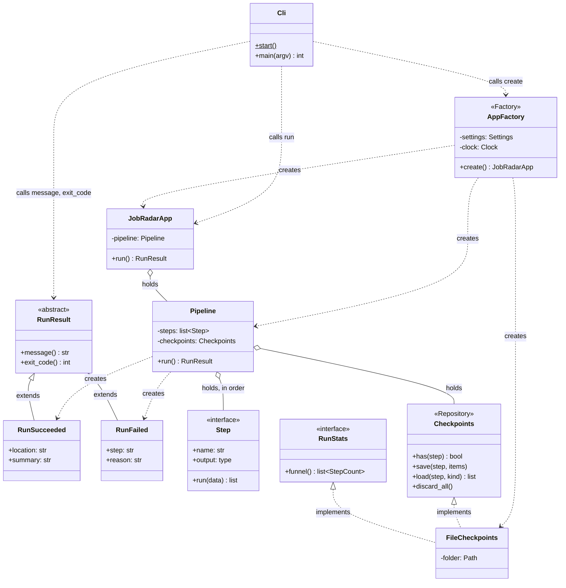
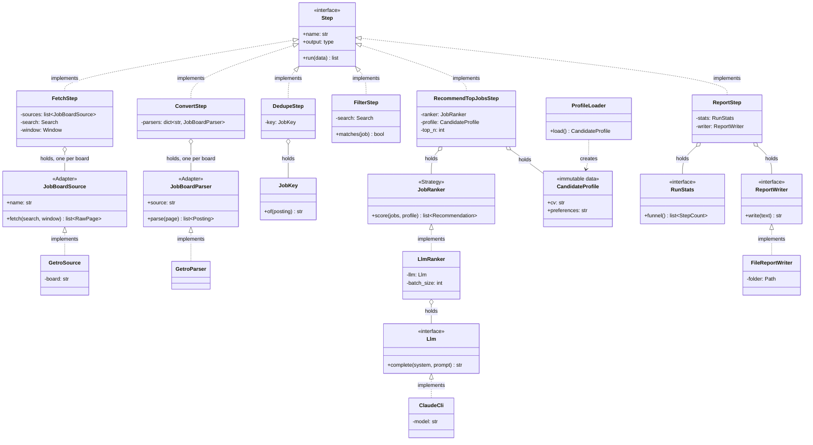
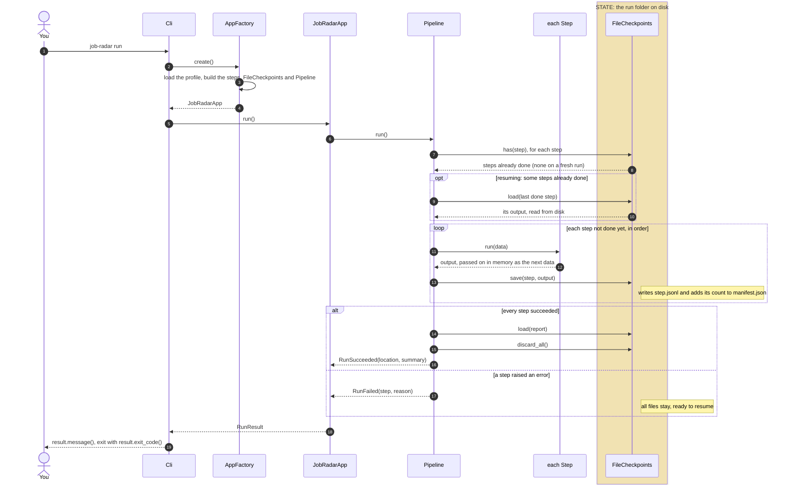
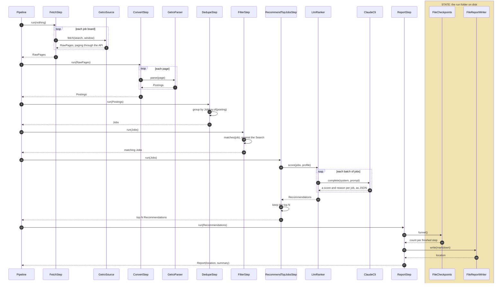

# Architecture

How the code is put together: which classes exist, what each one is responsible for, which others it knows, and where state lives. Every box is a real class, named as in the code. The reasons behind each part are in [design.md](design.md).

**Shown now:** the design for the first real run, agreed on Nov 4. PR #2 builds it as a skeleton: every class and its signatures, no internals. Later PRs fill in one class at a time; each PR that changes the flow updates these diagrams.

The first real run: `job-radar run` fetches Fast Forward through its search API, turns the records into postings, dedupes them into jobs, keeps the jobs that match the search, asks the LLM which fit the CV best, and writes a report with the top N and a few counts.

## Rules the design follows

- **One responsibility per class**, and each class knows the fewest neighbours it can
- **Depend on interfaces.** Only `AppFactory` knows concrete classes
- **No state in memory.** Every class is configured once at creation and never changes. A run's state lives in its folder on disk, written only by `FileCheckpoints` and `FileReportWriter`
- **Steps exchange lists of models**, so one generic save and load works for every step

## Classes and dependencies

Two diagrams: the app and the pipeline that runs the steps, then the steps and what each one uses. Boxes marked with a pattern name (Repository, Adapter, Strategy) are interfaces.

### App and pipeline



### Steps and what they use



How to read the arrows:

| Arrow | Means |
|---|---|
| `..\|>` dashed, hollow triangle | Implements the interface |
| `--\|>` solid, hollow triangle | Extends the class |
| `..>` dashed | Uses: calls the named functions, or creates the object |
| `o--` hollow diamond | Holds as a configured part, set once at creation, never changed |

### What each step takes and gives

The pipeline saves each step's output and passes it to the next step in memory. Only a resumed run reads from disk, once, to get the last saved output.

| Step | Name in the run folder | Takes | Gives |
|---|---|---|---|
| `FetchStep` | `fetch` | nothing | `RawPage`s from each job board |
| `ConvertStep` | `convert` | `RawPage`s | `Posting`s |
| `DedupeStep` | `dedupe` | `Posting`s | `Job`s, one per real job |
| `FilterStep` | `filter` | `Job`s | `Job`s that match the search |
| `RecommendTopJobsStep` | `recommend` | `Job`s | the top N `Recommendation`s, each with its `Job`, a score and a reason |
| `ReportStep` | `report` | `Recommendation`s | `Report`: where it is and a one-line summary |

## Responsibilities and neighbours

One responsibility per class. "Knows" is everything the class imports or calls; nothing else.

| Class | Pattern | Responsibility | Knows |
|---|---|---|---|
| `Cli` | Entry point | Turn the command line into a call; print the result; return the exit code | `AppFactory`, `JobRadarApp`, `RunResult` |
| `AppFactory` | Factory | Build the app for one command. The only class that knows concrete classes | all of them |
| `JobRadarApp` | | Launch the pipeline for one command and hand back how it ended | `Pipeline`, `RunResult` |
| `RunResult`, `RunSucceeded`, `RunFailed` | Polymorphism | Say how a run ended, in words and as an exit code | nothing |
| `Pipeline` | Pipeline | Run the steps in order; skip steps already saved; save each output; turn an error into `RunFailed` and the final `Report` into `RunSucceeded`; delete the checkpoints on success | `Step`, `Checkpoints`, `Report`, `RunResult` |
| `Step` | Interface | The shape every step shares | models |
| `Checkpoints` | Repository | Save and load each step's output for one run; record counts in the manifest; delete the outputs once the run succeeds | models |
| `RunStats` | Interface | Read-only: how many items each finished step produced | models |
| `FileCheckpoints` | Implements both | One JSON Lines file per step, plus `manifest.json`, in the run folder | its run folder |
| `FetchStep` | Step | Fetch raw pages from every configured job board | `JobBoardSource` |
| `JobBoardSource`, `GetroSource` | Adapter | Query one board's API, page by page | the board's API |
| `ConvertStep` | Step | Send each raw page to the parser for its board | `JobBoardParser` |
| `JobBoardParser`, `GetroParser` | Adapter | Turn one board's records into `Posting`s | the board's format |
| `DedupeStep` | Step | Group postings of the same job into one `Job` | `JobKey` |
| `JobKey` | | Decide which postings are the same job | `Posting` |
| `FilterStep` | Step | Keep the jobs that match every criterion set in the search | `Search` |
| `RecommendTopJobsStep` | Step | Keep the N best-scored jobs | `JobRanker`, `CandidateProfile` |
| `JobRanker`, `LlmRanker` | Strategy | Score jobs against the CV and preferences, in batches | `Llm` |
| `Llm`, `ClaudeCli` | Interface | Send one prompt to a language model; `ClaudeCli` runs `claude -p` on the subscription | `claude -p` |
| `ProfileLoader` | | Read the CV and preferences from `local/` into a `CandidateProfile` | `local/` |
| `ReportStep` | Step | Build the Markdown report: the funnel and the top N | `RunStats`, `ReportWriter` |
| `ReportWriter`, `FileReportWriter` | Interface | Store the finished report and say where it is | its run folder |
| `Clock` | | The current time, so tests can fix it | the system clock |
| Models | Immutable data | Passed between classes | nothing |

## One run

### From the command to the result

The pipeline's view: every step is a black box. The run folder is the only state.



- `Cli` never checks which result it got; each result knows its own message and exit code
- A failed run keeps every saved step, so a later run can resume after the last one that finished
- Outputs pass between steps in memory; the disk is read only when resuming, since nothing is in memory yet

### Inside the steps

The same run, opening the black boxes. The save and load around each step (above) are left out.



## The run folder

Each run gets its own folder, named by its start time:

```
output/runs/2026-11-05T10-00/
    fetch.jsonl  convert.jsonl  dedupe.jsonl  filter.jsonl  recommend.jsonl  report.jsonl
    manifest.json     # each finished step and how many items it produced
    report.md
```

After a successful run only `manifest.json` and `report.md` remain. After a failed run everything stays, ready to resume.
