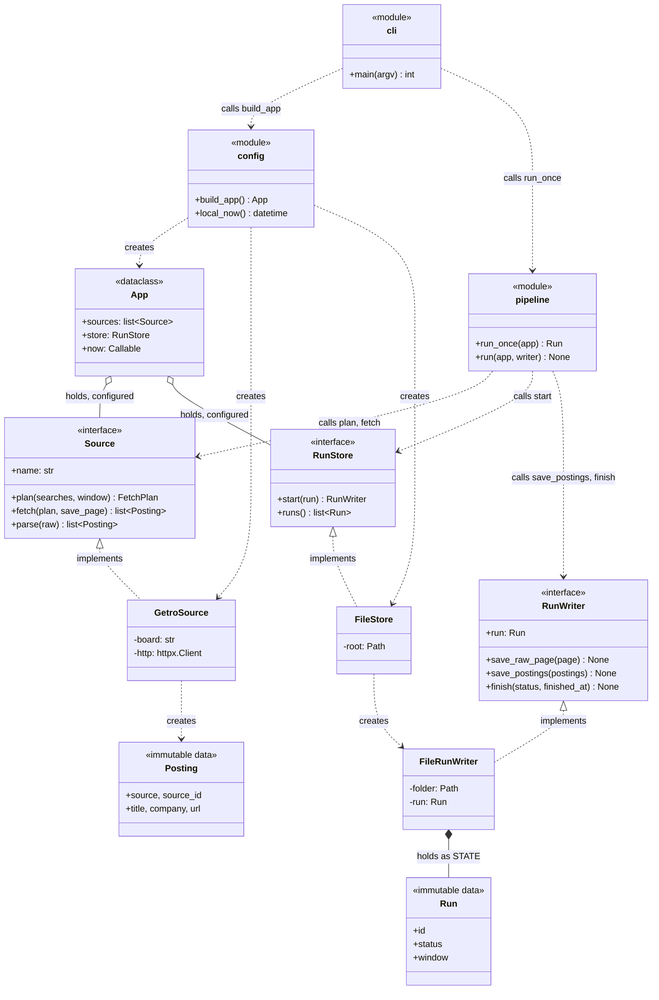
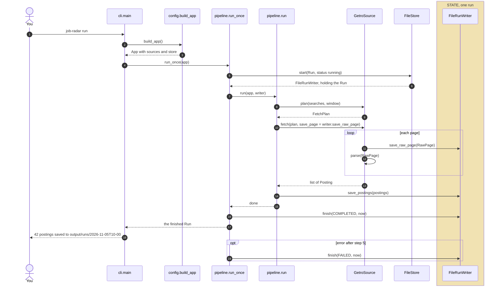

# Architecture

How the code is put together: which classes exist, what each one is responsible for, which others it knows, and where state lives. Every box is a real module or class, named as in the code. The reasons behind each part are in [design.md](design.md).

These diagrams show only what is built, and grow with each PR that changes the flow.

**Shown now:** PR #2 (models and interfaces) and the first slice (next): `job-radar run` fetches Fast Forward through its search API, turns each record into a `Posting`, and saves the postings in a run folder.

## Classes and relationships

How to read the arrows:

| Arrow | Means |
|---|---|
| `..\|>` dashed, hollow triangle | Implements the interface |
| `..>` dashed | Uses: calls the named functions, or creates the object |
| `o--` hollow diamond | Holds as a configured part, set once, never changed |
| `*--` filled diamond | Holds as **state**: owns it and is the only one that changes it |

## Responsibilities and neighbours

One responsibility per box. "Knows" is everything the box imports or calls; nothing else.

| Box | File | PR | Responsibility | Knows |
|---|---|---|---|---|
| `cli` | `cli.py` | #1, slice | Turn the command line into a call; print the outcome | `config`, `pipeline` |
| `config` | `config.py` | #2, slice | Wire concrete classes together into an `App`. The only place that knows them | `App`, `GetroSource`, `FileStore`, `httpx` |
| `App` | `config.py` | #2 | Carry the configured parts to the pipeline | `Source`, `RunStore` (interfaces) |
| `pipeline.run_once` | `pipeline.py` | slice | Open and close one run: start it, finish it as completed or failed | `App`, `RunStore`, `RunWriter` (interfaces), `run` |
| `pipeline.run` | `pipeline.py` | slice | The steps of a run, in order | `Source`, `RunWriter` (interfaces), models |
| `Source` | `sources/base.py` | #2 | Contract for any job source | models |
| `GetroSource` | `sources/getro.py` | slice | Query Fast Forward's search API; convert its records to `Posting`s | `httpx`, models. Not the store: pages go to the `save_page` function it is given |
| `RunStore` | `store/base.py` | #2 | Contract for where runs live | models, `RunWriter` |
| `FileStore` | `store/files.py` | slice | Keep runs as folders under `output/`: start new ones, list them | `FileRunWriter`, the disk |
| `RunWriter` | `store/base.py` | #2, slice | Contract for saving one run's data | models |
| `FileRunWriter` | `store/files.py` | slice | Write one run's files; own that run's record | its run folder, models |
| `Run`, `Posting` and other models | `model.py` | #2 | Immutable data passed between the boxes | nothing |

What this buys:

- `pipeline` never names a concrete class, so a second source or a different store plugs in through `config` alone
- `GetroSource` can be tested without any store: give it a list's `append` as `save_page`
- State is in one place: `FileRunWriter` holds the `Run`. Everything else is configured once or is immutable data

## One run (first slice)

- Only `run_once` starts and finishes the run, so a failure anywhere still closes it as failed
- Only `run` talks to the source and the writer for the steps in between
- `GetroSource` hands raw pages to a function and returns postings; it never holds the writer
