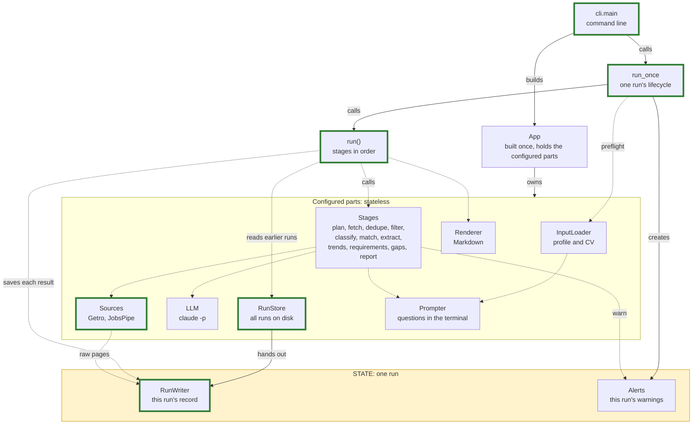
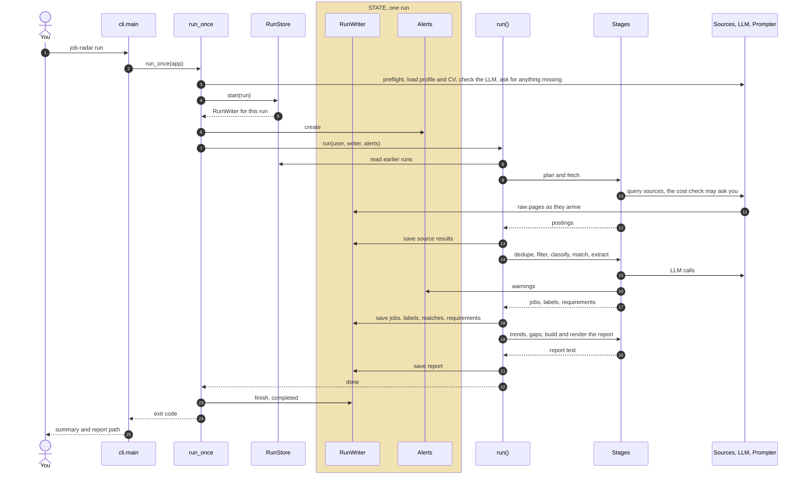

# Architecture

How the parts of job-radar connect, who owns what, and where state lives. The details behind each part are in [design.md](design.md).

These diagrams grow with the build: each PR that changes the flow updates them.

## Components

- **Solid arrow**: creates or owns. **Dashed arrow**: calls
- **Yellow box**: the only state, and it lasts one run. Everything else is configured once and keeps nothing between calls
- **Thick green border**: built and running. Until the first slice is merged, it marks what that slice builds: `job-radar run` fetches Fast Forward, turns each record into a `Posting`, and saves the postings in a run folder

## One run

- `run_once` opens and closes the run. On any error after step 4, it closes the run as failed instead
- `run()` is the only part that reads earlier runs from the store and writes through the writer
- Stages compute and return data; they hold no state and no reference to the writer or the alerts
