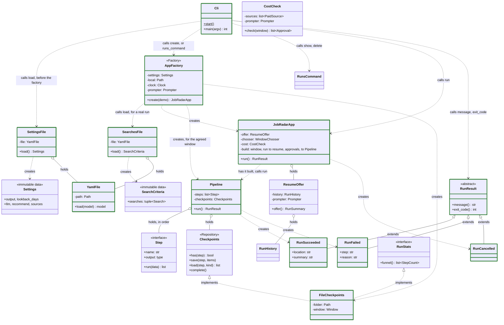
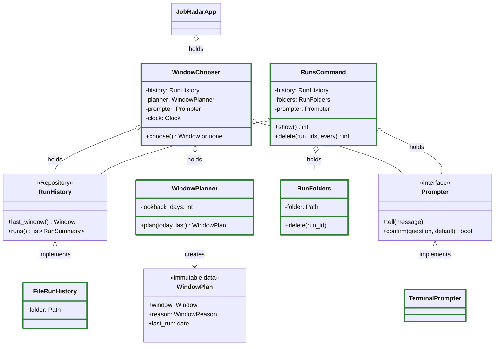
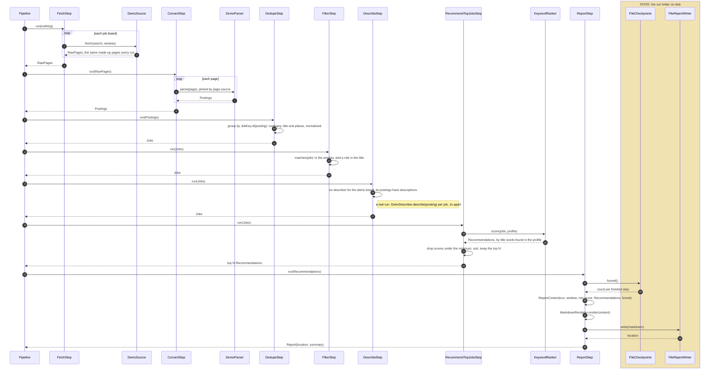

# Architecture

How the code is put together: which classes exist, what each one is responsible for, which others it knows, and where state lives. Every box is a real class, named as in the code. The reasons behind each part are in [design.md](design.md).

**Shown now:** the design for the first real run, agreed on Nov 4. PR #2 built it as a skeleton: every class and its signatures, no internals. PR #3 made the whole run work end to end on made-up data (`job-radar run --demo`), with every step in a simple form. PR #4 agrees each run's window with the user before anything is fetched. PR #5 fetches real Fast Forward jobs. PR #6 merges postings of the same job and filters on roles. PR #7 fetches full descriptions for the jobs the filter keeps. PR #8 numbers the step files in the run folder in run order. PR #9 ranks real runs with the LLM against your CV and preferences. PR #10 completes the report: work mode, salary and posted date for each job, a minimum score, YAML front matter, and a renderer that only formats. PR #11 is the first limited real run: default roles in code, and two layout fixes it found. PR #12 reads `local/settings.yaml` over the defaults and the searches from `local/profile.yaml`; a job is kept if it matches any search. PR #13 adds the search criteria on a posting's own fields: excluded titles, work mode, places as ISO codes, minimum salary, each with `if_missing`. PR #14 lists what the filter dropped, by reason, in `dropped.md` next to the report. PR #15 adds `job-radar runs` and `job-radar delete`. PR #16 resumes a failed run: the same command offers it, and the pipeline skips the saved steps. PR #17 notes in the report the days a long break left out. PR #18 merges postings on the employer's own id, read from ATS links, and on company, title and country. PR #19 drops jobs an earlier completed run already found, in `NewJobsFilterStep`. PR #20 adds JobsPipe, a paid API, off by default and capped per run, and moves the default settings into `job_radar/default_settings.yaml`, which the app reads first. PR #21 agrees what paid sources may spend before anything is fetched. PR #22 labels each job (seniority, job type, domain, sector) and adds a match step for the `seniority` and `domains` criteria. PR #23 finds what each matched job asks for: skills, tools, certifications and years. PR #24 carries jobs the LLM's usage limit stopped over to the next run. PR #25 adds market trends to the report: periods, coverage, figures, the change and notes on changed searches or sources. PR #26 adds the What employers ask for section. Classes with a green border work now; the others are still signatures only. Each later PR swaps one simple or demo part for the real one and updates these diagrams.

The first real run: `job-radar run` fetches Fast Forward through its search API, turns the records into postings, dedupes them into jobs, keeps the jobs that match the search, fetches their full descriptions, asks the LLM which fit the CV best, and writes a report with the top N and a few counts. The demo run takes the same steps, with a made-up board, a made-up profile and keyword scoring in place of the LLM.

## Rules the design follows

- **One responsibility per class**, and each class knows the fewest neighbours it can
- **Depend on interfaces.** Only `AppFactory` knows concrete classes
- **No state in memory.** Every class is configured once at creation and never changes. A run's state lives in its folder on disk, written only by `FileCheckpoints` and `FileReportWriter`
- **Steps exchange lists of models**, so one generic save and load works for every step

## Classes and dependencies

Three diagrams: the app and the pipeline that runs the steps, how the app agrees the run's window, then the steps and what each one uses. Boxes marked with a pattern name (Repository, Adapter, Strategy) are interfaces.

### App and pipeline



`JobRadarApp` holds `WindowChooser` (next diagram).

### Agreeing the window



### Steps and what they use

```mermaid
classDiagram
    direction TB

    class Step {
        <<interface>>
        +name: str
        +output: type
        +run(data) list
    }
    class FetchStep {
        -sources: list~JobBoardSource~
        -criteria: SearchCriteria
        -window: Window
        -approvals: dict~str, Approval~
        -log: SpendLog
    }
    class PaidSource {
        <<interface>>
        +plan(criteria, window) SpendPlan
        +fetch_paid(criteria, window, cap) PaidFetch
    }
    class SpendLog {
        <<interface>>
        +write(spend)
        +spends() list~Spend~
    }
    class FileSpendLog {
        -folder: Path
    }
    class JobBoardSource {
        <<Adapter>>
        +name: str
        +fetch(criteria, window) list~RawPage~
    }
    class GetroSource {
        -network: str
        -client: BoardClient
    }
    class JobsPipeSource {
        -client: BoardClient
        -filters: dict
        -max_jobs: int
        -prompter: Prompter
        +query(search, window) dict
    }
    class JobsPipeParser
    class Secrets {
        <<interface>>
        +get(name) str
    }
    class EnvSecrets {
        -path: Path
    }
    class BoardClient {
        -http: httpx.Client
        -delay: float
        +pause()
        +get(url) Response
        +post(url) Response
    }
    class DemoSource
    class ConvertStep {
        -parsers: dict~str, JobBoardParser~
    }
    class JobBoardParser {
        <<Adapter>>
        +source: str
        +parse(page) list~Posting~
    }
    class GetroParser
    class DemoParser
    class DedupeStep {
        -key: JobKey
        -today: date
    }
    class NewJobsFilterStep {
        -seen: SeenJobs
        -today: date
        -new_only: bool
    }
    class SeenJobs {
        <<interface>>
        +keys(today) frozenset~str~
    }
    class FileSeenJobs {
        -history: RunHistory
        -folder: Path
    }
    class JobKey {
        -normalizer: Normalizer
        -ats: AtsLinks
        +keys(posting) tuple~str~
        +fuzzy(posting) str
    }
    class AtsLinks {
        +key(url) str
    }
    class Normalizer {
        +company(name) str
        +title(title, places) str
        +place(place) str
    }
    class FilterStep {
        -criteria: SearchCriteria
        -window: Window
        -matcher: JobMatcher
        -log: DropLog
    }
    class DropLog {
        <<interface>>
        +write(drops)
    }
    class FileDropLog {
        -folder: Path
        -words: Words
    }
    class Words {
        +details(posting) str
        +day(day) str
        +span(start, end) str
    }
    class JobMatcher {
        -normalizer: Normalizer
        +miss(job, search) str
    }
    class PlaceCodes {
        +locate(location) Location
    }
    class DescribeStep {
        -describers: dict~str, JobDescriber~
        -prompter: Prompter
    }
    class ClassifyStep {
        -classifier: Classifier
        -prompter: Prompter
    }
    class Classifier {
        <<Strategy>>
        +classify(jobs) dict~str, Classification~
    }
    class LlmClassifier {
        -llm: Llm
        -job_types: dict
        -domains: dict
    }
    class TitleClassifier
    class MatchStep {
        -criteria: SearchCriteria
        -matcher: JobMatcher
    }
    class ExtractStep {
        -extractor: Extractor
        -prompter: Prompter
        -guard: UsageLimitGuard
    }
    class UsageLimitGuard {
        -prompter: Prompter
        -pending: PendingLog
        +run(work, jobs, verb) tuple
    }
    class PendingLog {
        <<interface>>
        +add(jobs)
        +jobs() list~Job~
    }
    class FilePendingLog {
        -folder: Path
    }
    class CarriedOverStep {
        -pending: PendingJobs
    }
    class LastRunPending {
        -history: RunHistory
        -folder: Path
    }
    class Extractor {
        <<Strategy>>
        +extract(jobs) dict~str, Extraction~
    }
    class LlmExtractor {
        -llm: Llm
    }
    class KeywordExtractor
    class JobDescriber {
        <<Adapter>>
        +source: str
        +pace: float
        +describe(posting) str
    }
    class GetroDescriber {
        -network: str
        -client: BoardClient
        -html: HtmlText
    }
    class HtmlText {
        +text(html) str
    }
    class RecommendTopJobsStep {
        -ranker: JobRanker
        -profile: CandidateProfile
        -top_n: int
    }
    class JobRanker {
        <<Strategy>>
        +score(jobs, profile) list~Recommendation~
    }
    class LlmRanker {
        -llm: Llm
        -batch_size: int
        -description_chars: int
    }
    class KeywordRanker
    class Llm {
        <<interface>>
        +complete(system, prompt, schema) str
    }
    class ClaudeCli {
        -model: str
        -timeout: float
        +check()
    }
    class ProfileLoader {
        -folder: Path
        +load() CandidateProfile
    }
    class CandidateProfile {
        <<immutable data>>
        +cv: str
        +preferences: str
    }
    class ReportStep {
        -stats: RunStats
        -renderer: ReportRenderer
        -writer: ReportWriter
        -trends: TrendSource
        -asks: AskSource
        -run_id: str
        -window: Window
        -min_score: int
    }
    class TrendSource {
        <<interface>>
        +trends() Trends
    }
    class MarketTrends {
        -runs: RunsSource
        -builder: TrendBuilder
    }
    class TrendBuilder {
        -period: str
        +build(runs) Trends
    }
    class RunsSource {
        <<interface>>
        +runs() list~RunJobs~
    }
    class MarketRuns {
        -history: RunHistory
        -this_run: KeptJobs
    }
    class AskSource {
        <<interface>>
        +asks() Asks
    }
    class MarketAsks {
        -runs: RunsSource
        -builder: AskBuilder
        -today: date
    }
    class AskBuilder {
        -days: int
        -per_type: int
        -names: RequirementNames
        +build(jobs, today) Asks
    }
    class RequirementNames {
        +key(name) str
    }
    class ReportRenderer {
        <<interface>>
        +render(content) str
    }
    class MarkdownRenderer {
        -words: Words
    }
    class ReportContent {
        <<immutable data>>
        +run: str
        +window: Window
        +not_covered: Window
        +min_score: int
        +recommendations: tuple~Recommendation~
        +funnel: tuple~StepCount~
    }
    class RunStats {
        <<interface>>
        +funnel() list~StepCount~
    }
    class ReportWriter {
        <<interface>>
        +write(text) str
    }
    class FileReportWriter {
        -folder: Path
    }

    Step <|.. FetchStep : implements
    Step <|.. ConvertStep : implements
    Step <|.. DedupeStep : implements
    Step <|.. NewJobsFilterStep : implements
    NewJobsFilterStep o-- SeenJobs : holds
    SeenJobs <|.. FileSeenJobs : implements
    Step <|.. FilterStep : implements
    Step <|.. DescribeStep : implements
    Step <|.. ClassifyStep : implements
    Step <|.. MatchStep : implements
    ClassifyStep o-- Classifier : holds
    Classifier <|.. LlmClassifier : implements
    Classifier <|.. TitleClassifier : implements
    LlmClassifier o-- Llm : holds
    MatchStep o-- JobMatcher : holds
    Step <|.. ExtractStep : implements
    Step <|.. CarriedOverStep : implements
    ExtractStep o-- UsageLimitGuard : holds
    ClassifyStep o-- UsageLimitGuard : holds
    RecommendTopJobsStep o-- UsageLimitGuard : holds
    UsageLimitGuard o-- PendingLog : holds
    PendingLog <|.. FilePendingLog : implements
    CarriedOverStep o-- LastRunPending : holds
    ExtractStep o-- Extractor : holds
    Extractor <|.. LlmExtractor : implements
    Extractor <|.. KeywordExtractor : implements
    LlmExtractor o-- Llm : holds
    Step <|.. RecommendTopJobsStep : implements
    Step <|.. ReportStep : implements
    FetchStep o-- JobBoardSource : holds, one per board
    JobBoardSource <|.. GetroSource : implements
    JobBoardSource <|.. JobsPipeSource : implements
    PaidSource <|.. JobsPipeSource : implements
    JobRadarApp o-- CostCheck : holds
    CostCheck o-- PaidSource : holds
    FetchStep o-- SpendLog : holds
    SpendLog <|.. FileSpendLog : implements
    JobsPipeSource o-- BoardClient : holds, with the key
    JobBoardSource <|.. DemoSource : implements
    GetroSource o-- BoardClient : holds
    ConvertStep o-- JobBoardParser : holds, one per board
    JobBoardParser <|.. GetroParser : implements
    JobBoardParser <|.. JobsPipeParser : implements
    JobsPipeParser o-- PlaceCodes : holds
    Secrets <|.. EnvSecrets : implements
    JobBoardParser <|.. DemoParser : implements
    DedupeStep o-- JobKey : holds
    JobKey o-- Normalizer : holds
    JobKey o-- AtsLinks : holds
    FilterStep o-- JobMatcher : holds
    FilterStep o-- DropLog : holds
    DropLog <|.. FileDropLog : implements
    FileDropLog o-- Words : holds
    MarkdownRenderer o-- Words : holds
    JobMatcher o-- Normalizer : holds
    GetroParser o-- PlaceCodes : holds
    DemoParser o-- PlaceCodes : holds
    DescribeStep o-- JobDescriber : holds, one per board that needs it
    JobDescriber <|.. GetroDescriber : implements
    GetroDescriber o-- BoardClient : holds, shared with GetroSource
    GetroDescriber o-- HtmlText : holds
    RecommendTopJobsStep o-- JobRanker : holds
    JobRanker <|.. LlmRanker : implements
    JobRanker <|.. KeywordRanker : implements
    LlmRanker o-- Llm : holds
    Llm <|.. ClaudeCli : implements
    RecommendTopJobsStep o-- CandidateProfile : holds
    ProfileLoader ..> CandidateProfile : creates
    ReportStep o-- RunStats : holds
    ReportStep o-- TrendSource : holds
    TrendSource <|.. MarketTrends : implements
    MarketTrends o-- TrendBuilder : holds
    MarketTrends o-- RunsSource : holds
    RunsSource <|.. MarketRuns : implements
    MarketRuns o-- RunHistory : holds
    ReportStep o-- AskSource : holds
    AskSource <|.. MarketAsks : implements
    MarketAsks o-- RunsSource : holds
    MarketAsks o-- AskBuilder : holds
    AskBuilder o-- RequirementNames : holds
    ReportStep o-- ReportRenderer : holds
    ReportStep ..> ReportContent : creates
    ReportRenderer <|.. MarkdownRenderer : implements
    ReportStep o-- ReportWriter : holds
    ReportWriter <|.. FileReportWriter : implements

    style FetchStep stroke:#2e7d32,stroke-width:3px
    style FileSpendLog stroke:#2e7d32,stroke-width:3px
    style CostCheck stroke:#2e7d32,stroke-width:3px
    style ConvertStep stroke:#2e7d32,stroke-width:3px
    style DedupeStep stroke:#2e7d32,stroke-width:3px
    style JobKey stroke:#2e7d32,stroke-width:3px
    style AtsLinks stroke:#2e7d32,stroke-width:3px
    style Normalizer stroke:#2e7d32,stroke-width:3px
    style FilterStep stroke:#2e7d32,stroke-width:3px
    style FileSeenJobs stroke:#2e7d32,stroke-width:3px
    style NewJobsFilterStep stroke:#2e7d32,stroke-width:3px
    style Words stroke:#2e7d32,stroke-width:3px
    style FileDropLog stroke:#2e7d32,stroke-width:3px
    style PlaceCodes stroke:#2e7d32,stroke-width:3px
    style JobMatcher stroke:#2e7d32,stroke-width:3px
    style DescribeStep stroke:#2e7d32,stroke-width:3px
    style ClassifyStep stroke:#2e7d32,stroke-width:3px
    style LlmClassifier stroke:#2e7d32,stroke-width:3px
    style TitleClassifier stroke:#2e7d32,stroke-width:3px
    style MatchStep stroke:#2e7d32,stroke-width:3px
    style ExtractStep stroke:#2e7d32,stroke-width:3px
    style UsageLimitGuard stroke:#2e7d32,stroke-width:3px
    style FilePendingLog stroke:#2e7d32,stroke-width:3px
    style CarriedOverStep stroke:#2e7d32,stroke-width:3px
    style LastRunPending stroke:#2e7d32,stroke-width:3px
    style LlmExtractor stroke:#2e7d32,stroke-width:3px
    style KeywordExtractor stroke:#2e7d32,stroke-width:3px
    style GetroDescriber stroke:#2e7d32,stroke-width:3px
    style BoardClient stroke:#2e7d32,stroke-width:3px
    style HtmlText stroke:#2e7d32,stroke-width:3px
    style RecommendTopJobsStep stroke:#2e7d32,stroke-width:3px
    style ReportStep stroke:#2e7d32,stroke-width:3px
    style TrendBuilder stroke:#2e7d32,stroke-width:3px
    style MarketTrends stroke:#2e7d32,stroke-width:3px
    style MarketRuns stroke:#2e7d32,stroke-width:3px
    style MarketAsks stroke:#2e7d32,stroke-width:3px
    style AskBuilder stroke:#2e7d32,stroke-width:3px
    style RequirementNames stroke:#2e7d32,stroke-width:3px
    style FileReportWriter stroke:#2e7d32,stroke-width:3px
    style MarkdownRenderer stroke:#2e7d32,stroke-width:3px
    style DemoSource stroke:#2e7d32,stroke-width:3px
    style GetroSource stroke:#2e7d32,stroke-width:3px
    style EnvSecrets stroke:#2e7d32,stroke-width:3px
    style JobsPipeParser stroke:#2e7d32,stroke-width:3px
    style JobsPipeSource stroke:#2e7d32,stroke-width:3px
    style GetroParser stroke:#2e7d32,stroke-width:3px
    style DemoParser stroke:#2e7d32,stroke-width:3px
    style KeywordRanker stroke:#2e7d32,stroke-width:3px
    style LlmRanker stroke:#2e7d32,stroke-width:3px
    style ClaudeCli stroke:#2e7d32,stroke-width:3px
    style ProfileLoader stroke:#2e7d32,stroke-width:3px
```



How to read the arrows:

| Arrow | Means |
|---|---|
| `..\|>` dashed, hollow triangle | Implements the interface |
| `--\|>` solid, hollow triangle | Extends the class |
| `..>` dashed | Uses: calls the named functions, or creates the object |
| `o--` hollow diamond | Holds as a configured part, set once at creation, never changed |
| Green border | Works now, some in a simple form ([tasks.md](tasks.md) says which); no colour means signatures only, or an interface |

### What each step takes and gives

The pipeline saves each step's output and passes it to the next step in memory. Only a resumed run reads from disk, once, to get the last saved output.

| Step | Name in the run folder | Takes | Gives |
|---|---|---|---|
| `FetchStep` | `fetch` | nothing | `RawPage`s from each job board |
| `ConvertStep` | `convert` | `RawPage`s | `Posting`s |
| `DedupeStep` | `dedupe` | `Posting`s | `Job`s, one per real job |
| `NewJobsFilterStep` | `new_jobs_filter` | `Job`s | the `Job`s no earlier completed run found |
| `FilterStep` | `filter` | `Job`s | `Job`s that match any search |
| `CarriedOverStep` | `carried_over` | `Job`s | the same `Job`s, then those the last completed run carried over that this run didn't find again |
| `DescribeStep` | `describe` | `Job`s | the same `Job`s, each primary posting with its full description |
| `ClassifyStep` | `classify` | `Job`s | the same `Job`s, each with its labels (none when the LLM couldn't) |
| `MatchStep` | `match` | `Job`s | the `Job`s that meet every criterion of a search, labels included |
| `ExtractStep` | `extract` | `Job`s | the same `Job`s, each with its requirements (none when the LLM couldn't) |
| `RecommendTopJobsStep` | `recommend` | `Job`s | the top N `Recommendation`s at or above the minimum score, each with its `Job`, a score and a reason |
| `ReportStep` | `report` | `Recommendation`s | `Report`: where it is and a one-line summary |

## Responsibilities and neighbours

One responsibility per class. "Knows" is everything the class imports or calls; nothing else.

| Class | Pattern | Responsibility | Knows |
|---|---|---|---|
| `Cli` | Entry point | Turn the command line into a call; print the result; return the exit code | `AppFactory`, `JobRadarApp`, `RunResult` |
| `AppFactory` | Factory | Build the app for one command, real or demo. The only class that knows concrete classes | all of them |
| `SettingsFile` | | Read `job_radar/default_settings.yaml`, then merge `local/settings.yaml` over it at any depth; no local file means every default. `Settings` holds only types and limits | `YamlFile`, `Settings` |
| `SearchesFile` | | Read the searches from `local/profile.yaml`, filling each from `common`; required for a real run | `YamlFile`, `SearchCriteria` |
| `YamlFile` | | Read one YAML file into a model; errors name the file and the key's path | `pyyaml`, models |
| `JobRadarApp` | | Resume the last run if it failed and the user says yes, or agree a new window; have the pipeline built for it, launch it, and hand back how it ended | `ResumeOffer`, `WindowChooser`, `Pipeline`, `RunResult` |
| `ResumeOffer` | | When the newest run didn't complete, ask whether to resume it (Enter for yes) | `RunHistory`, `Prompter`, `Words` |
| `RunResult`, `RunSucceeded`, `RunFailed`, `RunCancelled` | Polymorphism | Say how a run ended, in words and as an exit code | nothing |
| `WindowChooser` | | Tell the user which dates the run fetches and why; ask first on a first run or after a long break | `RunHistory`, `WindowPlanner`, `Prompter`, `Clock` |
| `WindowPlanner` | | Decide the window from today, the last completed run and the lookback | `Window` |
| `RunHistory`, `FileRunHistory` | Repository | Read-only: every run (id, window, completed or not, its steps) and the window of the last completed one, from the run folders | the run folders |
| `RunFolders` | | Delete a run folder, only one that exists directly under the runs folder | the run folders |
| `RunsCommand` | | `job-radar runs`: list runs, newest first. `job-radar delete`: delete runs after asking, Enter meaning no | `RunHistory`, `RunFolders`, `Prompter`, `Words` |
| `Prompter`, `TerminalPrompter` | Interface | Tell the user things and ask yes or no in the terminal | the terminal |
| `Pipeline` | Pipeline | Run the steps in order; skip the steps already saved and read the last of them back; save each output; turn an error into `RunFailed` and the final `Report` into `RunSucceeded`; delete the checkpoints on success | `Step`, `Checkpoints`, `Report`, `RunResult` |
| `Step` | Interface | The shape every step shares | models |
| `Checkpoints` | Repository | Save and load each step's output for one run; record counts in the manifest; once the run succeeds, mark it completed and delete the outputs | models |
| `RunStats` | Interface | Read-only: how many items each finished step produced | models |
| `FileCheckpoints` | Implements both | One JSON Lines file per step, numbered in run order (`01-fetch.jsonl`), plus `manifest.json` (the window, each step's count, completed or not), in the run folder | its run folder |
| `FetchStep` | Step | Fetch raw pages from every configured job board; a paid one within its approval, or not at all when skipped, recording what it spent | `JobBoardSource`, `PaidSource`, `SpendLog` |
| `CostCheck` | | Before anything is fetched: each paid source's free estimate against the per-run max, the budget and the credits left; go ahead on its own within them, else ask go ahead, skip or stop (Enter for skip) | `PaidSource`, `Prompter` |
| `SpendLog`, `FileSpendLog` | Repository | Keep what each paid source spent in a run, in `spend.jsonl`; the report reads it | its run folder |
| `JobBoardSource`, `GetroSource` | Adapter | Query one board's API, page by page; `GetroSource` stops at the page that reaches past the window | `BoardClient` |
| `JobsPipeSource` | Adapter, `PaidSource` | One JobsPipe search per user search, with the criteria and the JobsPipe-only filters sent; cursor paging within the agreed cap. Its plan is free: the account's credits and an estimate of the matches; the plan (free, seeker) sets the per-run max and monthly budget unless settings override them | `BoardClient`, `Prompter` |
| `JobsPipeParser` | Adapter | Turn JobsPipe records into `Posting`s: its country and state codes, work arrangement, yearly pay, full description | `PlaceCodes`, `HtmlText` |
| `Secrets`, `EnvSecrets` | Interface | Read an API key from the environment, else from `.env` | the environment, `.env` |
| `BoardClient` | | Send one board's requests at its pace (1s for Getro), retrying timeouts, server errors and rate limits | the board's API |
| `ConvertStep` | Step | Send each raw page to the parser for its board | `JobBoardParser` |
| `JobBoardParser`, `GetroParser` | Adapter | Turn one board's records into `Posting`s, places with their codes | the board's format, `PlaceCodes` |
| `PlaceCodes` | | Read country and region ISO codes from a place's text ("Seattle, WA, USA" is `US`, `US-WA`); none when it can't ("Remote") | `pycountry` |
| `DemoSource`, `DemoParser` | Adapter | A made-up board: the same postings every run, for `--demo` and tests | `Posting` |
| `DedupeStep` | Step | Group postings that share any key into one `Job`, transitively; the job's id is its primary posting's strongest key | `JobKey` |
| `JobKey` | | A posting's identity keys: the ATS key from its link, if any, and a fuzzy key on company, title and countries in canonical form | `Posting`, `Normalizer`, `AtsLinks` |
| `AtsLinks` | | Read the employer's id for an opening from a Greenhouse, Lever, Ashby or Workable link | nothing |
| `Normalizer` | | Put company names, titles and places in canonical form for comparing | nothing |
| `NewJobsFilterStep` | Step | Drop jobs with a key an earlier completed run kept; with `new_only` off, keep all | `SeenJobs` |
| `SeenJobs`, `FileSeenJobs` | Repository | Read-only: the keys of jobs completed runs kept in `jobs.jsonl`; strong keys for good, fuzzy keys for 60 days | `RunHistory`, the run folders |
| `FilterStep` | Step | Keep the jobs posted in the window that match any search | `SearchCriteria`, `Window`, `JobMatcher` |
| `JobMatcher` | | Say whether a job meets one search, and which criterion it fails first: roles, excluded title, work mode, location, salary; `if_missing` settles what the posting doesn't say | `Normalizer` |
| `DescribeStep` | Step | Fill in the full description of each kept job's primary posting, through the describer for its board; say first how long it takes. Jobs that have one, or whose board has no describer, pass through | `JobDescriber`, `Prompter` |
| `ClassifyStep` | Step | Add labels to every job; say how many the classifier couldn't label | `Classifier`, `Prompter` |
| `Classifier`, `LlmClassifier`, `TitleClassifier` | Strategy | Label seniority, job type, domain and sector: `LlmClassifier` 50 jobs a prompt from the start of each description, job types and domains from settings, a retry then a split per bad answer; `TitleClassifier` seniority from title words, for `--demo` | `Llm` |
| `MatchStep` | Step | Keep the jobs that meet every criterion of some search, now with seniority and domain | `SearchCriteria`, `JobMatcher` |
| `UsageLimitGuard` | | Run one LLM pass (classify, extract, rank); when the usage limit stops it, ask finish and carry the rest over, or stop (Enter for finish) | `Prompter`, `PendingLog` |
| `PendingLog`, `FilePendingLog` | Repository | Keep the jobs a run carries over in `pending.jsonl`, kept after the run | its run folder |
| `CarriedOverStep`, `LastRunPending` | Step | Add the last completed run's carried-over jobs after the filter, unless this run found them again | `RunHistory`, the run folders |
| `ExtractStep` | Step | Add requirements to every matched job; say how many the extractor couldn't read | `Extractor`, `Prompter` |
| `Extractor`, `LlmExtractor`, `KeywordExtractor` | Strategy | Find what a posting asks for, as skills, tools, certifications and years: `LlmExtractor` 10 jobs a prompt from descriptions up to 8,000 characters, a retry then a split per bad answer, names only tidied; `KeywordExtractor` a short list of names, for `--demo` | `Llm` |
| `JobDescriber`, `GetroDescriber` | Adapter | Fetch one posting's description as plain text; `GetroDescriber` makes one request per job and gives nothing for a job the board no longer has or lists | `BoardClient`, `HtmlText` |
| `HtmlText` | | Turn HTML into plain text that keeps paragraphs, line breaks and lists | nothing |
| `RecommendTopJobsStep` | Step | Keep the N best-scored jobs that reach the minimum score (40 by default) | `JobRanker`, `CandidateProfile` |
| `JobRanker`, `LlmRanker` | Strategy | Score jobs against the CV and preferences, 20 to a prompt, with a JSON schema; check the answer scores every job once, ask again once if not | `Llm` |
| `KeywordRanker` | Strategy | Score a job by the share of its title words found in the profile, for `--demo` and tests | models |
| `Llm`, `ClaudeCli` | Interface | Send one prompt to a language model; `ClaudeCli` runs `claude -p` on the subscription, one plain turn from an empty folder, and checks the login before a run | `claude` |
| `ProfileLoader` | | Read the CV (`cv.pdf`, `cv.md` or `cv.txt`) and `preferences.md` from `local/` into a `CandidateProfile`; say what's missing | `local/` |
| `ReportStep` | Step | Put together what the report says (`ReportContent`: the run, its window, the recommended jobs, the market trends, what employers ask for, the funnel), then have it formatted and written | `RunStats`, `TrendSource`, `AskSource`, `ReportRenderer`, `ReportWriter` |
| `RunsSource`, `MarketRuns` | Interface | Gather the runs the market sections look at: the completed runs (their `jobs.jsonl`, windows and configs) and this run (its kept output); free | `RunHistory`, `KeptJobs` |
| `TrendSource`, `MarketTrends` | Interface | Have the trends worked out over those runs | `RunsSource`, `TrendBuilder` |
| `TrendBuilder` | | Work out the trend periods (week, month or quarter), each one's covered days, figures (postings per covered day, work mode, salary, seniority), the change against the last complete period, and notes on changed searches or sources | models |
| `AskSource`, `MarketAsks` | Interface | Have what employers ask for counted over those runs' matched jobs, for the window ending on the run's last day; free | `RunsSource`, `AskBuilder` |
| `AskBuilder` | | Count the requirements of the matched jobs with an extraction in a rolling window one trend period long, against the window before: per type the top N with share, change in points, median years and the ids of the jobs they came from | `RequirementNames`, models |
| `RequirementNames` | | Put requirement names in one form (case, punctuation, version numbers, a trailing "programming" or "language", a few aliases), so spellings of one thing count as one | nothing |
| `ReportRenderer`, `MarkdownRenderer` | Interface | Format a report's content and decide nothing about it; `MarkdownRenderer` writes YAML front matter, then Markdown | `Words` |
| `DropLog`, `FileDropLog` | Interface | Keep the list of jobs the filter dropped; `FileDropLog` writes `dropped.md`, grouped by why, titles sorted | its run folder, `Words` |
| `Words` | | Put work modes, places, pay and dates into the same plain words in every file a run writes | models |
| `ReportWriter`, `FileReportWriter` | Interface | Store the finished report and say where it is | its run folder |
| `Clock` | | The current time, so tests can fix it | the system clock |
| Models | Immutable data | Passed between classes | nothing |

## One run

### From the command to the result

The app's view, as built now: the pipeline's steps are a black box. The run folders are the only state.

```mermaid
sequenceDiagram
    autonumber
    actor U as You
    participant cli as Cli
    participant f as AppFactory
    participant app as JobRadarApp
    participant wc as WindowChooser
    participant pr as TerminalPrompter
    participant p as Pipeline
    participant s as each Step
    box rgba(255, 193, 7, 0.25) STATE: the run folders on disk
        participant h as FileRunHistory
        participant cp as FileCheckpoints
    end

    U->>cli: job-radar run --demo
    cli->>cli: SettingsFile.load(): local/settings.yaml over the defaults
    cli->>f: create(demo)
    f->>f: pick the demo parts (a real run reads profile.yaml, the CV and preferences, and checks the claude login)
    Note over cli,f: a setup error stops here: Cli prints it and exits with 2
    f-->>cli: JobRadarApp
    cli->>app: run()
    app->>app: ResumeOffer.offer(): if the newest run failed, ask "Resume it?"
    Note over app: yes: build the pipeline in that run's folder, with its window, and run it (below)
    app->>wc: choose()
    wc->>h: last_window()
    h-->>wc: the last completed run's window, or none
    wc->>wc: WindowPlanner.plan(today, last)
    wc->>pr: tell(which dates, and why)
    opt first run, or the last run is older than the lookback
        wc->>pr: confirm("Continue?")
        pr->>U: Continue? (y/n, Enter for y)
        U-->>pr: y or n
        pr-->>wc: yes or no
    end
    alt you said n
        wc-->>app: no window
        app-->>cli: RunCancelled: nothing fetched, no run folder
    else
        wc-->>app: the plan: the window, and the days a long break left out
        app->>f: build the pipeline for the window
        f->>f: make the run folder, build the steps, FileCheckpoints and Pipeline
        f-->>app: Pipeline
        app->>p: run()
        opt resuming
            p->>cp: has(step), from the first step on
            p->>cp: load(the last saved step), once
        end
        loop each step not saved yet, in order
            p->>s: run(data)
            s-->>p: output, passed on in memory as the next data
            p->>cp: save(step, output)
            Note right of cp: writes NN-step.jsonl, adds its count to manifest.json
        end
        alt every step succeeded
            p->>cp: complete()
            Note right of cp: marks the run completed, deletes the step files
            p-->>app: RunSucceeded(location, summary), from the Report in memory
        else a step raised an error
            p-->>app: RunFailed(step, reason)
            Note right of cp: all files stay; the run doesn't count as completed
        end
        app-->>cli: RunResult
    end
    cli-->>U: result.message(), exit with result.exit_code()
```

- `Cli` never checks which result it got; each result knows its own message and exit code
- A failed run keeps every saved step. Running the same command again offers to resume it: the pipeline skips the saved steps and loads the last saved output from disk, once
- Outputs pass between steps in memory; the disk is only written, except when resuming
- The window: a first run fetches the lookback (14 days). A later run starts one day before the last completed run's last day: that day again, since the last run may have been early in it, and one more, for postings listed a day late. Never further back than the lookback. Repeats are removed once jobs already seen are recognised (task 15)

### Inside the steps

The demo run, opening the black boxes. The save around each step (above) is left out. A real run puts `GetroSource` and `GetroParser` where the demo board is (built), `GetroDescriber` in the describe step (built: one request per kept job, 1s apart), and `LlmRanker` over `ClaudeCli` where `KeywordRanker` is (built: batches of 20, against your CV and preferences); dedupe gets stronger keys in task 15, and filter the full criteria in task 11.



## The run folder

Each run gets its own folder, named by its start time, to the second. Demo runs go under `output/demo/` instead of `output/runs/`, so they never move a real run's window:

```
output/runs/2026-11-05T10-00-00/
    01-fetch.jsonl  02-convert.jsonl  03-dedupe.jsonl  04-new_jobs_filter.jsonl  05-filter.jsonl
    06-carried_over.jsonl  07-describe.jsonl  08-classify.jsonl  09-match.jsonl  10-extract.jsonl
    11-recommend.jsonl  12-report.jsonl
    manifest.json     # the window, days left out after a long break, what the run searched for and where, each finished step and its count, completed or not
    report.md
    dropped.md        # what the filter dropped, by reason
    jobs.jsonl        # after success: the matched jobs, with labels and requirements, read by later runs as seen
    spend.jsonl       # what each paid source spent: estimate, decision, credits used and left
    pending.jsonl     # jobs the usage limit stopped, carried over to the next run
```

After a successful run only `manifest.json`, `report.md`, `dropped.md` and `jobs.jsonl` remain, and the manifest says the run completed. After a failed run everything stays, ready to resume.
