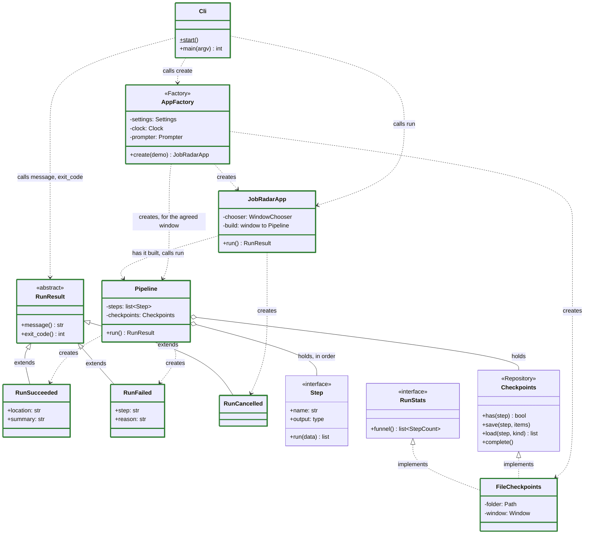
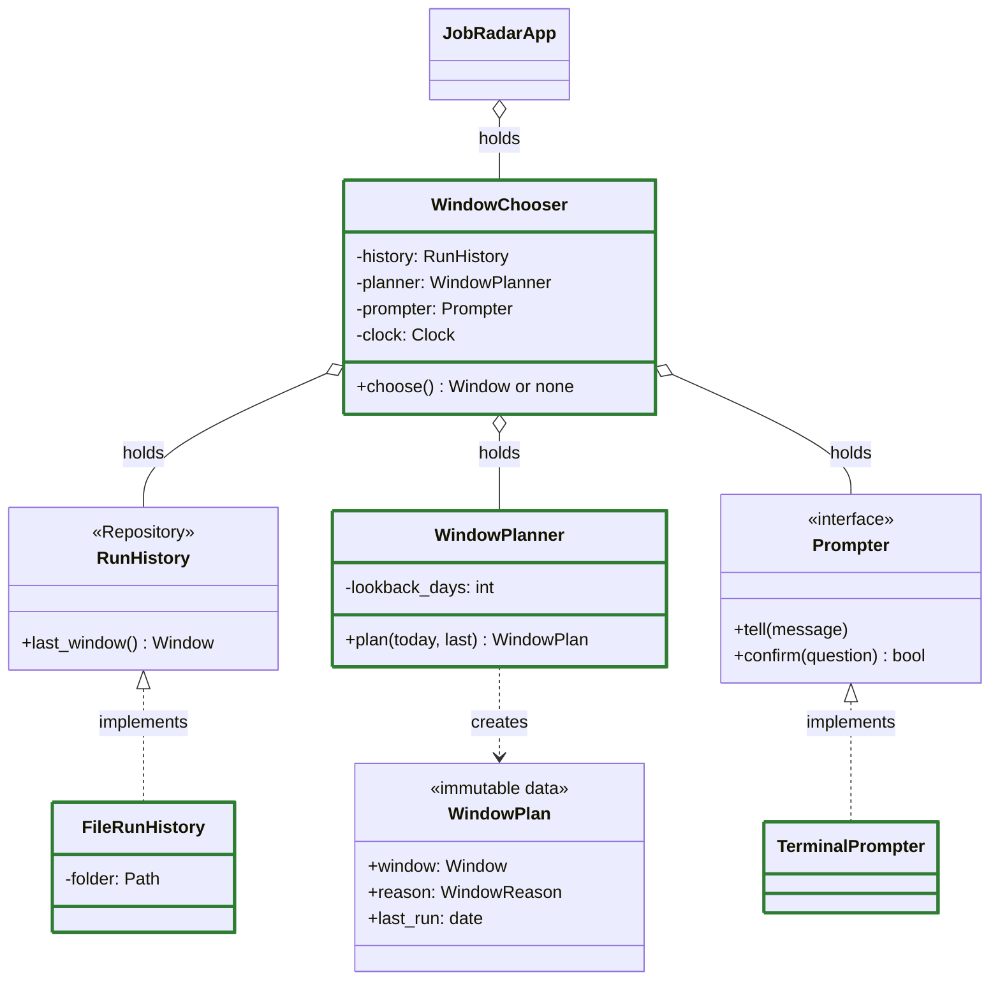
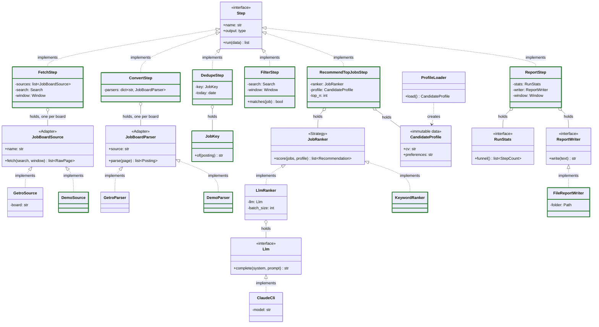
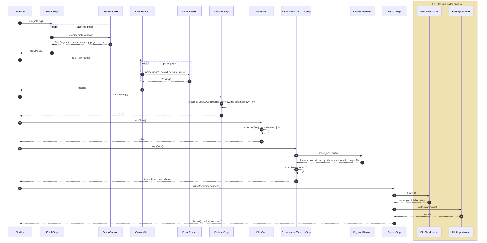

# Architecture

How the code is put together: which classes exist, what each one is responsible for, which others it knows, and where state lives. Every box is a real class, named as in the code. The reasons behind each part are in [design.md](design.md).

**Shown now:** the design for the first real run, agreed on Nov 4. PR #2 built it as a skeleton: every class and its signatures, no internals. PR #3 made the whole run work end to end on made-up data (`job-radar run --demo`), with every step in a simple form. PR #4 agrees each run's window with the user before anything is fetched. Classes with a green border work now; the others are still signatures only. Each later PR swaps one simple or demo part for the real one and updates these diagrams.

The first real run: `job-radar run` fetches Fast Forward through its search API, turns the records into postings, dedupes them into jobs, keeps the jobs that match the search, asks the LLM which fit the CV best, and writes a report with the top N and a few counts. The demo run takes the same steps, with a made-up board, a made-up profile and keyword scoring in place of the LLM.

## Rules the design follows

- **One responsibility per class**, and each class knows the fewest neighbours it can
- **Depend on interfaces.** Only `AppFactory` knows concrete classes
- **No state in memory.** Every class is configured once at creation and never changes. A run's state lives in its folder on disk, written only by `FileCheckpoints` and `FileReportWriter`
- **Steps exchange lists of models**, so one generic save and load works for every step

## Classes and dependencies

Three diagrams: the app and the pipeline that runs the steps, how the app agrees the run's window, then the steps and what each one uses. Boxes marked with a pattern name (Repository, Adapter, Strategy) are interfaces.

### App and pipeline



`JobRadarApp` holds `WindowChooser` (next diagram).

### Agreeing the window



### Steps and what they use



How to read the arrows:

| Arrow | Means |
|---|---|
| `..\|>` dashed, hollow triangle | Implements the interface |
| `--\|>` solid, hollow triangle | Extends the class |
| `..>` dashed | Uses: calls the named functions, or creates the object |
| `o--` hollow diamond | Holds as a configured part, set once at creation, never changed |
| Green border | Works now, some in a simple form ([tasks.md](tasks.md) says which); no colour means signatures only, or an interface |

### What each step takes and gives

The pipeline saves each step's output and passes it to the next step in memory. Only a resumed run reads from disk, once, to get the last saved output.

| Step | Name in the run folder | Takes | Gives |
|---|---|---|---|
| `FetchStep` | `fetch` | nothing | `RawPage`s from each job board |
| `ConvertStep` | `convert` | `RawPage`s | `Posting`s |
| `DedupeStep` | `dedupe` | `Posting`s | `Job`s, one per real job |
| `FilterStep` | `filter` | `Job`s | `Job`s that match the search |
| `RecommendTopJobsStep` | `recommend` | `Job`s | the top N `Recommendation`s, each with its `Job`, a score and a reason |
| `ReportStep` | `report` | `Recommendation`s | `Report`: where it is and a one-line summary |

## Responsibilities and neighbours

One responsibility per class. "Knows" is everything the class imports or calls; nothing else.

| Class | Pattern | Responsibility | Knows |
|---|---|---|---|
| `Cli` | Entry point | Turn the command line into a call; print the result; return the exit code | `AppFactory`, `JobRadarApp`, `RunResult` |
| `AppFactory` | Factory | Build the app for one command, real or demo. The only class that knows concrete classes | all of them |
| `JobRadarApp` | | Agree the window, have the pipeline built for it, launch it, and hand back how it ended | `WindowChooser`, `Pipeline`, `RunResult` |
| `RunResult`, `RunSucceeded`, `RunFailed`, `RunCancelled` | Polymorphism | Say how a run ended, in words and as an exit code | nothing |
| `WindowChooser` | | Tell the user which dates the run fetches and why; ask first on a first run or after a long break | `RunHistory`, `WindowPlanner`, `Prompter`, `Clock` |
| `WindowPlanner` | | Decide the window from today, the last completed run and the lookback | `Window` |
| `RunHistory`, `FileRunHistory` | Repository | Read-only: the window of the last completed run, from the run folders | the run folders |
| `Prompter`, `TerminalPrompter` | Interface | Tell the user things and ask yes or no in the terminal | the terminal |
| `Pipeline` | Pipeline | Run the steps in order; skip steps already saved; save each output; turn an error into `RunFailed` and the final `Report` into `RunSucceeded`; delete the checkpoints on success | `Step`, `Checkpoints`, `Report`, `RunResult` |
| `Step` | Interface | The shape every step shares | models |
| `Checkpoints` | Repository | Save and load each step's output for one run; record counts in the manifest; once the run succeeds, mark it completed and delete the outputs | models |
| `RunStats` | Interface | Read-only: how many items each finished step produced | models |
| `FileCheckpoints` | Implements both | One JSON Lines file per step, plus `manifest.json` (the window, each step's count, completed or not), in the run folder | its run folder |
| `FetchStep` | Step | Fetch raw pages from every configured job board | `JobBoardSource` |
| `JobBoardSource`, `GetroSource` | Adapter | Query one board's API, page by page | the board's API |
| `ConvertStep` | Step | Send each raw page to the parser for its board | `JobBoardParser` |
| `JobBoardParser`, `GetroParser` | Adapter | Turn one board's records into `Posting`s | the board's format |
| `DemoSource`, `DemoParser` | Adapter | A made-up board: the same postings every run, for `--demo` and tests | `Posting` |
| `DedupeStep` | Step | Group postings of the same job into one `Job` | `JobKey` |
| `JobKey` | | Decide which postings are the same job | `Posting` |
| `FilterStep` | Step | Keep the jobs that match every criterion set in the search and were posted in the window | `Search`, `Window` |
| `RecommendTopJobsStep` | Step | Keep the N best-scored jobs | `JobRanker`, `CandidateProfile` |
| `JobRanker`, `LlmRanker` | Strategy | Score jobs against the CV and preferences, in batches | `Llm` |
| `KeywordRanker` | Strategy | Score a job by the share of its title words found in the profile, for `--demo` and tests | models |
| `Llm`, `ClaudeCli` | Interface | Send one prompt to a language model; `ClaudeCli` runs `claude -p` on the subscription | `claude -p` |
| `ProfileLoader` | | Read the CV and preferences from `local/` into a `CandidateProfile` | `local/` |
| `ReportStep` | Step | Build the Markdown report: the funnel and the top N | `RunStats`, `ReportWriter` |
| `ReportWriter`, `FileReportWriter` | Interface | Store the finished report and say where it is | its run folder |
| `Clock` | | The current time, so tests can fix it | the system clock |
| Models | Immutable data | Passed between classes | nothing |

## One run

### From the command to the result

The app's view, as built now: the pipeline's steps are a black box. The run folders are the only state.

```mermaid
sequenceDiagram
    autonumber
    actor U as You
    participant cli as Cli
    participant f as AppFactory
    participant app as JobRadarApp
    participant wc as WindowChooser
    participant pr as TerminalPrompter
    participant p as Pipeline
    participant s as each Step
    box rgba(255, 193, 7, 0.25) STATE: the run folders on disk
        participant h as FileRunHistory
        participant cp as FileCheckpoints
    end

    U->>cli: job-radar run --demo
    cli->>f: create(demo)
    f->>f: pick the demo parts (a real run loads the profile)
    Note over cli,f: a setup error stops here: Cli prints it and exits with 2
    f-->>cli: JobRadarApp
    cli->>app: run()
    app->>wc: choose()
    wc->>h: last_window()
    h-->>wc: the last completed run's window, or none
    wc->>wc: WindowPlanner.plan(today, last)
    wc->>pr: tell(which dates, and why)
    opt first run, or the last run is older than the lookback
        wc->>pr: confirm("Continue?")
        pr->>U: Continue? (y/n, Enter for y)
        U-->>pr: y or n
        pr-->>wc: yes or no
    end
    alt you said n
        wc-->>app: no window
        app-->>cli: RunCancelled: nothing fetched, no run folder
    else
        wc-->>app: the window
        app->>f: build the pipeline for the window
        f->>f: make the run folder, build the steps, FileCheckpoints and Pipeline
        f-->>app: Pipeline
        app->>p: run()
        loop each step, in order
            p->>s: run(data)
            s-->>p: output, passed on in memory as the next data
            p->>cp: save(step, output)
            Note right of cp: writes step.jsonl, adds its count to manifest.json
        end
        alt every step succeeded
            p->>cp: complete()
            Note right of cp: marks the run completed, deletes the step files
            p-->>app: RunSucceeded(location, summary), from the Report in memory
        else a step raised an error
            p-->>app: RunFailed(step, reason)
            Note right of cp: all files stay; the run doesn't count as completed
        end
        app-->>cli: RunResult
    end
    cli-->>U: result.message(), exit with result.exit_code()
```

- `Cli` never checks which result it got; each result knows its own message and exit code
- A failed run keeps every saved step. Resuming after the last one that finished comes in task 13: the pipeline will skip the saved steps and load the last saved output from disk, once
- Outputs pass between steps in memory; the disk is only written, except when resuming
- The window: a first run fetches the lookback (14 days). A later run starts one day before the last completed run's last day: that day again, since the last run may have been early in it, and one more, for postings listed a day late. Never further back than the lookback. Repeats are removed once jobs already seen are recognised (task 15)

### Inside the steps

The demo run, opening the black boxes. The save around each step (above) is left out. A real run puts `GetroSource` and `GetroParser` (task 5) and `LlmRanker` over `ClaudeCli` (task 7) where the demo parts are; dedupe and filter get their real rules in task 6.



## The run folder

Each run gets its own folder, named by its start time, to the second. Demo runs go under `output/demo/` instead of `output/runs/`, so they never move a real run's window:

```
output/runs/2026-11-05T10-00-00/
    fetch.jsonl  convert.jsonl  dedupe.jsonl  filter.jsonl  recommend.jsonl  report.jsonl
    manifest.json     # the window, each finished step and its count, completed or not
    report.md
```

After a successful run only `manifest.json` and `report.md` remain, and the manifest says the run completed. After a failed run everything stays, ready to resume.
